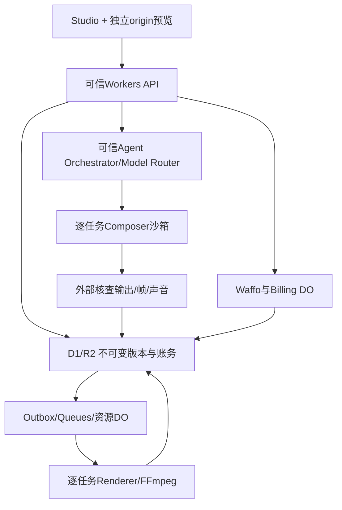

# 技术架构与数据契约

v2.2 consistency-1。创作自由不等于开放平台权限。14是跨模块协议，13是导演/制作方法，12为认证的唯一细则，05为交易细则。应用仍未部署。

## 1 技术与信任边界

| 层 | 技术与责任 |
| --- | --- |
| 网站/API | React、TypeScript、React Router/Vite与Cloudflare Workers/Static Assets；SSR、UI、鉴权、授权和协调 |
| UI | Tailwind、shadcn/ui Base UI、Lucide；既有杂志排版/专业工具配色及语义tokens，网站i18n/主题见10/11 |
| 数据/文件 | D1业务记录；私有R2存不可变素材、源码、音轨、帧和输出 |
| 调度 | Queues、DO、outbox、租约/generation、原子账务和资源准入 |
| AI | 一个可信Orchestrator + 工具 + Model Router；轻量Workers AI与通过实际基准的编码模型分工，不预先宣称最佳模型 |
| 创作与渲染 | 独立Composer/Renderer Container或经实测的Sandbox，Node/Chromium/FFmpeg/ffprobe；都执行不可信Composition，不能视固定镜像为可信代码 |
| 外部业务 | Google OIDC、Cloudflare Email Sending、Waffo；流程和密钥始终留可信服务 |
| 工具/观测 | mise、pnpm精确锁定，Logs/Analytics Engine/脱敏审计；Access+应用admin双重后台鉴权 |

不新增Supabase/Vercel/Redis或另一套后端部署。可以在受控容器预烘焙轨迹，但不换成浏览器录屏下载来逃避云端渲染。Web请求立即返回任务ID，不用HTTP长连接承担整片制作。

## 2 素材与自由Composition

用户素材准入由 `config/input-capabilities.json` 和01定义。图片方向、颜色、元信息规范化；视频原始版本只读保留、代理H.264、可恢复上传；音轨规范化48kHz。检查实际魔数/解码器而非扩展名，ZIP炸弹/大像素/异常时长/旋转和资源耗尽有硬上限；用户原始HTML/SVG上传与Agent在隔离工程中编写SVG/HTML严格分开。

上传intent绑定workspace/project/对象key/长度/过期；临时upload key不能覆盖正式资产。complete验证实际hash、尺寸和编码后建立新不可变asset_version，复制/重传不改变已购引用。原文/媒体不发送给任意模型；依用户明示用途与受控最小素材摘要/必要帧给批准provider，记录provider、用途和数据范围，不在日志留原录屏、源码或敏感prompt。

CompositionManifest、ReleaseSnapshot、FactManifest、EditRequest/PatchResult及RenderProtocol见14与 `contracts/production.schema.json`。项目版本唯一实体是`project_revisions`；source/variants/audio/facts是其内容引用，没有第二套composition_revisions。可有任意镜头、风格与算法，没有六类型或Clean/Bold准入限制。

时间为整数帧，seek绝对时间n/30，资源/字体/视频/Shader全部就绪才取帧，超时和旧响应要拒绝。平台target需验证 preset+aspect配对而非各自单独存在；原config六平台七target是唯一输出来源。14详细规定冷/逆序seek、消息身份、截图来源、内容hash与无损候选接受。

付款前固定所有合法target可执行源码、音轨和QA，MP4可以后编码。后续补平台不得再次调用Agent；新创意进入新稿，系统免费兼容修复不覆盖原源包/成片。preview与export使用同一runtime/源包/字体/音轨。UI主题、Cookie、Accept-Language不参与成片身份。

## 3 作业、资源预算和隔离

队列至少一次投递，outbox和业务写入同一D1原子批次，dispatcher/Cron可靠补发，不依赖waitUntil。DO按project协调checkout、grant、快照预留、退款冻结和发布；每个job按唯一输出指纹执行。消息重投不等于新attempt，generation阻止旧callback覆盖新结果。

全局4个物理容器同时涵盖素材、编码、Composer、预览、音频和QA；工作区最多2，创作/渲染各1，具体初值见agent-policy。单次600秒、心跳15秒、60秒无心跳先核查；渲染最多3次（15/60秒退避），源码修复累计最多2轮，两种计数不相乘。等待用户或预算暂停不持有容器；所有种类共同受同一准入DO控制，已收款任务预留容量与优先级。

**容器允许执行本任务Agent生成的任意合法动画源码**，不能访问任务manifest以外资源；不接收主站/支付/模型/D1/R2管理凭据、不挂其他租户目录。实例是信任边界，不把不同Linux用户当成强隔离。默认禁公网，可信资源代理只给当前job允许的素材和有限输出；仅设deniedHosts不算阻断所有端口。依赖离线锁定和许可审核，不执行未经审查生命周期脚本。

Composer和Renderer都按job/generation隔离，结束销毁，不复用含客户源码/内存/磁盘的长进程。每个生产renderer版本注册真实可执行Worker/镜像绑定；不只保存旧digest却覆盖唯一应用。日常升级只影响新快照；回滚不能删生产订单，老版本要能重试和补平台。

sandbox输出（包括self-reported QA）不可信，由可信服务重查。跨域预览不带主站Cookie，严格CSP/iframe权限、精确origin/source/nonce和消息schema校验；详见14。常规会话退出不取消已付款渲染，权限撤销/项目墓碑阻断未提交创作，删除/退款和迟到输出按14/05处理。

M0必须在实际Cloudflare目标规格验证30秒复杂片、字体/seek/WebGL能力、FFmpeg、回收及job隔离。本地PoC不能算云端支持；实例standard-3只是原有待测起点，具体SDK/调度策略按官方当前文档选兼容组合，镜像/runtime单独锁定。

## 4 数据实体与原子性

身份实体users/auth_identities/auth_flows/auth_action_intents/email_challenges/sessions、工作区/memberships/invites保留12既有唯一性和证明语义。OTP原码不持久化，identity不因同邮箱自动合并。D1没有本项目可依赖的自动租户RLS，每个查询都显式验证workspace。

内容实体projects、product_facts、assets/asset_versions/asset_refs、project_revisions、composition_sources/variants、creative_briefs/treatments、agent_runs/agent_run_steps、agent_candidates/agent_patches、fact_manifests/quality_reports及comments/edit_requests按14。可选内容语言元数据只辅助排版，不作创建门槛。

账务实体orders、active_checkout_slots、entitlement_grants、credit_reservations/credit_ledger、payment_inbox/refund_requests、export_snapshots/export_releases/export_artifacts、jobs/job_attempts/outbox、renderer_versions继续按05约束。增加creative_reservations/creative_ledger，不混入成片版本账本。付款授予、预留、消费和outbox同事务；不采用无条件读后减。

金额用整数最小币种单位，模型费用用整数USD micros；provider不同单位显式adapter转换，不用float。UTC存储，首次SSR未知用户时区用明确UTC，hydration后可显示当地时间，不能改视频确认日期。源码、事实、媒体、声音及各targethash是完整引用图，清理先查有效快照/任务引用。

## 5 第一方API

下表由 `config/routes.json` 对齐；Agent请求/响应结构在 `contracts/agent-api.json` 引用JSON Schema。未上线的storyboards/rewrites删除而非长期双栈；原exports/export-snapshots和draft restore保留，不另设releases API。所有端点是实施规格，不是已运行服务。

所有mutation使用请求ID/Idempotency-Key（同时提供须一致），结合actor/route/project/workspace及摘要去重，同键异体409。除协议外部回调外检查Origin/CSRF。资源缺权404，缺已知角色403，无会话401，输入422，限流429；未知路径404、错误方法405+Allow。错误形状沿用12的code/messageKey/安全params/message/fieldErrors/retryable/requestId；不回内部堆栈。Agent请求错误也采用同一外壳。

| 方法与路径 | 最低权限 | 契约 |
| --- | --- | --- |
| `POST /api/auth/google/start` | public | 完整输入、flow/proof/session、重试和回跳依12/10；本章不另设认证分支 |
| `GET /api/auth/google/callback` | oauth_state | 完整输入、flow/proof/session、重试和回跳依12/10；本章不另设认证分支 |
| `POST /api/auth/email/challenges` | public | 完整输入、flow/proof/session、重试和回跳依12/10；本章不另设认证分支 |
| `POST /api/auth/email/challenges/verify` | auth_flow | 完整输入、flow/proof/session、重试和回跳依12/10；本章不另设认证分支 |
| `POST /api/auth/email/challenges/resend` | auth_flow | 完整输入、flow/proof/session、重试和回跳依12/10；本章不另设认证分支 |
| `GET /api/auth/session` | public | 完整输入、flow/proof/session、重试和回跳依12/10；本章不另设认证分支 |
| `POST /api/auth/logout` | public | 完整输入、flow/proof/session、重试和回跳依12/10；本章不另设认证分支 |
| `POST /api/auth/links/confirm` | auth_flow | 完整输入、flow/proof/session、重试和回跳依12/10；本章不另设认证分支 |
| `POST /api/auth/registrations/confirm` | auth_flow | 完整输入、flow/proof/session、重试和回跳依12/10；本章不另设认证分支 |
| `DELETE /api/auth/flow` | auth_flow | 完整输入、flow/proof/session、重试和回跳依12/10；本章不另设认证分支 |
| `POST /api/preferences` | public | 完整输入、flow/proof/session、重试和回跳依12/10；本章不另设认证分支 |
| `GET /api/workspaces` | session | 有效会话；只列当前有效成员的工作区，含角色和默认选择，不接收任意userId |
| `GET /api/workspaces/:workspaceId` | member | 服务端从资源推导workspace并验证当前角色/版本/请求ID；既有业务范围不变 |
| `PATCH /api/workspaces/:workspaceId` | owner | 服务端从资源推导workspace并验证当前角色/版本/请求ID；既有业务范围不变 |
| `DELETE /api/workspaces/:workspaceId` | owner | 服务端从资源推导workspace并验证当前角色/版本/请求ID；既有业务范围不变 |
| `GET /api/workspaces/:workspaceId/members` | member | 服务端从资源推导workspace并验证当前角色/版本/请求ID；既有业务范围不变 |
| `DELETE /api/workspaces/:workspaceId/members/:userId` | owner | 服务端从资源推导workspace并验证当前角色/版本/请求ID；既有业务范围不变 |
| `POST /api/workspaces/:workspaceId/invites` | owner | 服务端从资源推导workspace并验证当前角色/版本/请求ID；既有业务范围不变 |
| `DELETE /api/workspaces/:workspaceId/invites/:inviteId` | owner | 服务端从资源推导workspace并验证当前角色/版本/请求ID；既有业务范围不变 |
| `POST /api/invites/accept` | session | 有效会话和显式确认；原子验证邀请有效/撤销/48h/单次和3人上限，重复同用户幂等 |
| `POST /api/workspaces/:workspaceId/owner-transfer` | owner | owner、目标当前成员、版本guard、12匹配actionIntent与双重确认；原子消费证明和更换角色，始终保留1位Owner |
| `GET /api/projects` | member | 明确workspaceId与受限分页；只列当前工作区可见项目/期限，不回其他租户 |
| `POST /api/projects` | member | 请求体workspaceId、audience/task、15或30秒、合法target；原子创建初始revision，配额不足429；无必填视频语言 |
| `GET /api/projects/:projectId` | member | 实际项目推导workspace；返回授权草稿、余额、期限与分页评论，匿名review不走本接口 |
| `PATCH /api/projects/:projectId/draft` | member | baseRevision；changes或restoreFromRevisionId二选一；CAS生成新稿，旧快照不变 |
| `POST /api/projects/:projectId/copies` | member | 同工作区复制源素材/草稿；新projectId不继承付款或重置累计免费配额，201；不可跨租户 |
| `DELETE /api/projects/:projectId` | member | 删除确认+版本guard；写墓碑、取消在途创作、撤销新授权，退款按05另处理 |
| `POST /api/projects/:projectId/assets/intents` | member | 文件声明、requestId；签发仅当前project/upload key的长度/期限/用途受限权限 |
| `POST /api/uploads/:uploadId/complete` | member | 校验上传归属、实际对象/声明hash、魔数、尺寸/时长；成功202处理job，非法422 |
| `POST /api/projects/:projectId/facts/confirm` | member | factIds和具体version；用户确认快照，旧值冲突409，AI不代确认 |
| `POST /api/projects/:projectId/preflight` | member | 检查当前revision，不触发支付；schema `preflightRequest` → `qualitySummary`，成功200 |
| `POST /api/projects/:projectId/export-snapshots` | member | 只冻结全部合法target已准备的源包；缺项409；schema `snapshotRequest` → `releaseSnapshot`，成功200 |
| `POST /api/billing/checkouts` | owner | 按05的订单/快照/权益/签名及最小下载授权，不能由Agent沙箱直接调用 |
| `POST /api/payments/waffo/webhook` | waffo_signature | 按05的订单/快照/权益/签名及最小下载授权，不能由Agent沙箱直接调用 |
| `GET /api/billing/orders` | owner | 按05的订单/快照/权益/签名及最小下载授权，不能由Agent沙箱直接调用 |
| `GET /api/billing/orders/:orderId` | owner | 按05的订单/快照/权益/签名及最小下载授权，不能由Agent沙箱直接调用 |
| `POST /api/projects/:projectId/exports` | member | 原成片版本账本预留/复用release；schema `exportRequest` → `exportManifest`，成功202 |
| `POST /api/exports/:releaseId/platforms` | member | 只运行既有冻结target；没有Agent创作；schema `platformRequest` → `exportManifest`，成功202 |
| `GET /api/jobs/:jobId` | member | 按真实job推导workspace，返回阶段/错误/进度，不泄露其他租户或provider密钥 |
| `POST /api/exports/:releaseId/downloads` | member | 按05的订单/快照/权益/签名及最小下载授权，不能由Agent沙箱直接调用 |
| `POST /api/projects/:projectId/share-links` | member | member、revision与有效期；可撤销只读链接，不授予源码下载、AI或订单访问 |
| `DELETE /api/projects/:projectId/share-links/:shareLinkId` | member | 校验链接确属项目；204撤销，后续预览/素材授权重查范围 |
| `POST /api/projects/:projectId/comments` | member | 普通成员评论，不暗中触发付费Agent；可无scene/element，绑定revision和帧 |
| `POST /api/support/tickets` | session | 有效会话、可选且有权访问的project/order、reason/message；返回站内编号，无权资源不泄露 |
| `POST /api/projects/:projectId/agent-runs` | member | 启动整片创作或显式准备平台源包；schema `agentRequest` → `runResult`，成功202 |
| `GET /api/projects/:projectId/agent-runs/:runId` | member | 读取阶段、方向候选、预算与结果；schema `no-body` → `runResult`，成功200 |
| `POST /api/projects/:projectId/agent-runs/:runId/resume` | member | 同run剩余预算内恢复；重新核对base和权限；schema `runAction` → `runResult`，成功202 |
| `POST /api/projects/:projectId/agent-runs/:runId/cancel` | member | 取消并使旧generation失效；schema `runAction` → `runResult`，成功200 |
| `GET /api/projects/:projectId/compositions/:revisionId` | member | 读取授权版本元数据；源码另走短期最小权限资产代理；schema `no-body` → `composition`，成功200 |
| `POST /api/projects/:projectId/previews` | member | 精确帧/短片段的受控预览；不开放免费高清交付；schema `previewRequest` → `previewResult`，成功202 |
| `GET /api/projects/:projectId/previews/:previewId` | member | 读取原revision和target预览状态；schema `no-body` → `previewResult`，成功200 |
| `POST /api/projects/:projectId/edit-requests` | member | 一次明确的Agent改稿，建立候选，不覆盖当前稿；schema `editRequest` → `runResult`，成功202 |
| `GET /api/projects/:projectId/patches/:patchId` | member | 显示diff影响和候选状态；schema `no-body` → `patchResult`，成功200 |
| `POST /api/projects/:projectId/patches/:patchId/apply` | member | 接受：CAS与权限/QA同事务；schema `applyRequest` → `patchResult`，成功200 |
| `POST /api/projects/:projectId/patches/:patchId/reject` | member | 拒绝候选，不修改当前版本；schema `applyRequest` → `patchResult`，成功200 |
| `GET /api/projects/:projectId/quality-reports/:revisionId` | member | 读取匹配源码hash的逐目标报告；不直接回传敏感prompt；schema `no-body` → `qualitySummary`，成功200 |

匿名review只用专门loader提供指定快照最小投影；token不能调用项目API。新Agent路由一律member，不拓展review权限。普通comments不自动产生AI消费；需要改稿时明确调用edit-requests。价格/回调域、snapshot来源、模型预算不能信任客户端任意值。

## 6 保存、删除和发布

免费7天/付费90天+7天宽限沿用05；同项目晚回调不让期限倒退，退款重算不删无关权益。主动删除立即墓碑、撤销分享/新执行并取消job，24小时内按既有删除规则清理不再合法引用的媒体；账务必要记录另保留。运行晚到文件不能复活项目，归入孤儿回收。候选截图/trace/源码许可的专门保留上限见14，不把72小时临时保留覆盖主动删除时限。

生产/预发布D1/R2/Queues/DO/支付配置/密钥独立。有会话/主题或语言Cookie的HTML与私有API no-store、绕过共享缓存；公共静态内容才CDN缓存。只开放真实功能，外部账户缺失时继续无依赖开发但不声称上线。
