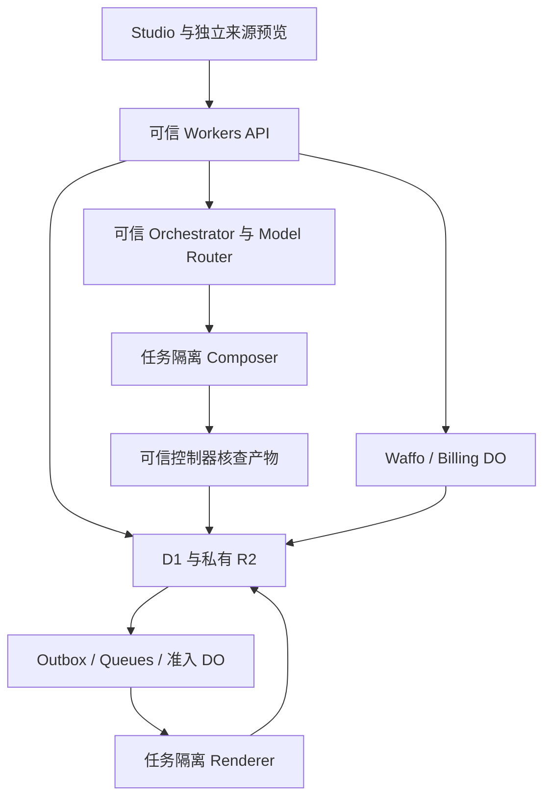

# 技术架构与数据契约

业务 API、鉴权、账务和模型凭据属于可信层；Composition 代码、评论、素材内容与沙箱输出都视为不可信数据。跨模块契约见 [14](14-production-contracts.md)，认证细则见 12，交易细则见 05。

## 1 技术与职责

| 层 | 技术与责任 |
| --- | --- |
| 网站/API | React、TypeScript、React Router/Vite、Cloudflare Workers/Static Assets；SSR、鉴权和协调 |
| UI | Tailwind、shadcn/ui Base UI、Lucide；杂志排版与专业工具配色，网站语言/主题见 10/11 |
| 状态/文件 | D1 业务记录；私有 R2 不可变素材、源码、音轨、帧、输出和必要证据 |
| 调度 | Queues、DO、outbox、租约与 generation、原子账务、全局算力准入 |
| AI | 一个可信 Orchestrator + 工具 + Model Router；Workers AI 可处理轻量任务，编码模型经真实基准配置 |
| 计算 | Composer/Renderer 独立沙箱，Node/Chromium/FFmpeg/ffprobe；都可能执行不可信代码 |
| 外部业务 | Google OIDC、Cloudflare Email Sending、Waffo；密钥留可信 Worker |
| 工具/观测 | mise、pnpm、精确锁文件，脱敏 Logs/Analytics，Access + 应用 admin |

不另引入数据库/部署厂商；Workers HTTP 只协调，不承担长时间 Chromium 或模型编排。返回持久 job ID，浏览器轮询不能成为交付依赖。

## 2 素材、源码和数据发送

准入来自 01 和 [输入配置](../../config/input-capabilities.json)。检验魔数/解码而非扩展名，限制文件大小、像素、时长、线程和内存；图片方向/色彩规范化，音频规范化 48 kHz。录屏可以生成 H.264 预览代理，但必须先验证目标 Chromium 构建支持的解码器；不支持则用经验证的兼容代理/预览抽帧，不能假设开源 Chromium 自带 H.264/AAC 解码。正式 Renderer 对实际使用的视频区间默认以 FFmpeg 按 PTS 确定性抽帧并复用受限缓存（含变帧率），不是无条件抽取所有上传帧；缺帧、PTS 不连续或资源越界明确失败。原始媒体与规范化 asset_version 都不可变。用户上传 HTML/SVG 与 Agent 在沙箱编写 HTML/SVG 严格区分。

上传 intent 绑定 workspace/project、临时 key、长度、用途和截止；complete 验实际字节 hash 后创建正式版本，不能覆盖已购引用。账号、项目和素材归属从数据库获取，不信客户端自报。只向已批准 provider 发送用户用途所需的最小素材摘要/必要帧；记录用途、provider 和数据范围，不将完整录屏、私有源码或敏感 prompt 写常规日志。

`project_revisions` 是唯一版本实体。CompositionManifest、ReleaseSnapshot、FactManifest、EditRequest/PatchResult、RenderProtocol 使用正式 Schema 和 14 的语义。源码可自由实现 DOM/SVG/Canvas/WebGL/3D/Shader，镜头及风格无固定枚举。绝对帧时钟、受控资源准备、冷/正/逆向 seek、精确消息身份与截图可信来源由 14 定义。

付款前准备全部合法目标来源；高清文件延后编码，补平台不再调用模型。预览与导出读取相同 runtime、源包、字体、音轨和冻结规则，输出帧需在冷/顺/逆向路径上可复现；预览允许使用不同媒体代理，但不能隐藏与最终抽帧/解码的内容差异。网站主题、Cookie、浏览器语言不改变成片。

## 3 队列、资源与隔离

业务更新与 outbox 在同一 D1 原子批次提交；dispatcher/Cron 扫描漏发，不依赖进程内 waitUntil。Queues 至少一次投递，重复消息复用同一 job，generation 作为 fencing token 阻止晚到结果覆盖。Billing DO 按项目协调 checkout、grant、快照预留、退款冻结和首次发布；网络等待后重新读取权威状态。

成功结果持久化后 ack；可恢复失败先原子写 attempt 和定时重试 outbox 再 ack；持久化失败不 ack。重试由一套应用调度控制，不同时叠加 Queue 重投与应用重试次数。渲染最多 3 次实际执行，退避 15/60 秒；模型内部修复最多 2 轮，累计预算共享。无效素材、未确认事实、确定性违规不盲重试。

[算力配置](../../config/agent-policy.json) 的全局 4 个物理容器覆盖素材、Composer、预览、音频、QA、Renderer 全部类别；工作区最多 2，创作/渲染各 1。子工具复用同容器令牌或另申请，不能持有全部令牌等子任务造成死锁。等待用户/预算暂停释放容器，已收款任务有预留容量和优先级。单次尝试、心跳与无心跳核查期限取配置；硬超时不是公开 SLA。

Composer/Renderer 都按 job/generation 隔离，结束销毁；不复用含客户源码、内存或文件的长期进程。实例是信任边界，不以不同 Linux 用户冒充隔离。默认禁公网，不携带支付、模型、D1/R2 管理或云平台凭据；资产代理只给当前任务的只读输入与有限输出。依赖离线镜像、锁定和许可审核，禁止未审查生命周期脚本。

不信源码自报 QA。预览使用独立 origin、无主站 Cookie、CSP/iframe 限权，bridge 校验 origin/source/nonce/session/schema；具体按 14。普通退出不取消已付款渲染，成员撤销/项目墓碑阻止未提交创作副作用。M0b 在真实 Cloudflare 验字体、视频 seek、WebGL 能力、编码、销毁重建和跨任务残留；本地 PoC 不替代。

## 4 实体与原子性

身份：users、auth_identities、auth_flows、auth_action_intents、email_challenges、sessions；工作区：workspaces、memberships、invites。证明、identity 唯一性、登录恢复按 12。D1 查询显式限定租户，不依赖自动 RLS。

内容：projects、product_facts、assets/asset_versions/asset_refs、project_revisions、composition_sources/variants、creative_briefs/treatments、agent_runs/agent_run_steps、agent_candidates/agent_patches、fact_manifests/quality_reports、comments/edit_requests。字段/关联/状态见 14；可无 scene/element 标记，不强制场景结构。

交易：orders、active_checkout_slots、entitlement_grants、credit_reservations/credit_ledger、payment_inbox、refund_requests、export_snapshots/export_releases/export_artifacts、jobs/job_attempts、outbox、renderer_versions。creative_reservations/creative_ledger 与成片账本分开。采用唯一约束、条件写、同事务 outbox，不无条件读后减余额。

货币使用整数最小单位，模型费用使用整数 USD micros；provider 单位由 adapter 明确转换。时间 UTC，UI 未知时区先标明 UTC，hydration 后可调整显示，但不改已确认的视频日期。素材、源码、事实、声音和 QA 构成引用图，清理必须先检查在途任务及有效购买。

## 5 第一方 API

URI 和权限以 [路由配置](../../config/routes.json) 为唯一注册来源；Agent 请求/响应在 [API 契约](../../contracts/agent-api.json) 引用 [正式 Schema](../../contracts/production.schema.json)。以下是可检查的实施清单，不是已部署服务。

普通业务 mutation 使用 requestId/Idempotency-Key，同时提供须一致；幂等范围包含 workspace/project/actor/route，请求摘要不一致返回 409。认证、外部回调的例外按 12/05，不把普通幂等缓存用于绕过 OTP 限次。Origin/CSRF、资源权限和生命周期在副作用前校验。无会话 401、已知角色不足 403、不可见资源 404、输入 422、限流 429；未知路径 404、方法 405+Allow。错误外壳为 code/messageKey/安全 params/message/fieldErrors/retryable/requestId。

| 方法与路径 | 最低权限 | 契约 |
| --- | --- | --- |
| `POST /api/auth/google/start` | public | 认证/证明/会话与请求恢复按 12；偏好按 10；不套用普通创作重试规则。 |
| `GET /api/auth/google/callback` | oauth_state | 认证/证明/会话与请求恢复按 12；偏好按 10；不套用普通创作重试规则。 |
| `POST /api/auth/email/challenges` | public | 认证/证明/会话与请求恢复按 12；偏好按 10；不套用普通创作重试规则。 |
| `POST /api/auth/email/challenges/verify` | auth_flow | 认证/证明/会话与请求恢复按 12；偏好按 10；不套用普通创作重试规则。 |
| `POST /api/auth/email/challenges/resend` | auth_flow | 认证/证明/会话与请求恢复按 12；偏好按 10；不套用普通创作重试规则。 |
| `GET /api/auth/session` | public | 认证/证明/会话与请求恢复按 12；偏好按 10；不套用普通创作重试规则。 |
| `POST /api/auth/logout` | public | 认证/证明/会话与请求恢复按 12；偏好按 10；不套用普通创作重试规则。 |
| `POST /api/auth/links/confirm` | auth_flow | 认证/证明/会话与请求恢复按 12；偏好按 10；不套用普通创作重试规则。 |
| `POST /api/auth/registrations/confirm` | auth_flow | 认证/证明/会话与请求恢复按 12；偏好按 10；不套用普通创作重试规则。 |
| `DELETE /api/auth/flow` | auth_flow | 认证/证明/会话与请求恢复按 12；偏好按 10；不套用普通创作重试规则。 |
| `POST /api/preferences` | public | 认证/证明/会话与请求恢复按 12；偏好按 10；不套用普通创作重试规则。 |
| `GET /api/workspaces` | session | 当前 session 的合法成员工作区，不接受任意 userId。 |
| `GET /api/workspaces/:workspaceId` | member | 当前成员的工作区、角色和品牌；不泄露其他租户。 |
| `PATCH /api/workspaces/:workspaceId` | owner | Owner 修改名称/品牌等允许字段并带版本 guard，不能伪造成员或额度。 |
| `DELETE /api/workspaces/:workspaceId` | owner | Owner、近期 reauth actionIntent、版本 guard 与明确确认；墓碑/取消/清理；财务保留和退款独立。 |
| `GET /api/workspaces/:workspaceId/members` | member | 成员身份与角色按必要范围返回。 |
| `DELETE /api/workspaces/:workspaceId/members/:userId` | owner | Owner、目标当前成员、版本 guard；不能移除最后 Owner；后续请求和在途副作用重查授权。 |
| `POST /api/workspaces/:workspaceId/invites` | owner | Owner，48 小时单次高熵邀请，返回复制链接；不自动发邮件。 |
| `DELETE /api/workspaces/:workspaceId/invites/:inviteId` | owner | Owner，邀请属于该工作区，撤销不删除已建立成员。 |
| `POST /api/invites/accept` | session | 显式接受并原子校验有效邀请、当前成员与 3 人上限；同用户成功重试幂等。 |
| `POST /api/workspaces/:workspaceId/owner-transfer` | owner | 当前 Owner、目标成员、版本 guard、对应 reauth actionIntent 与确认；原子消费证明并更换角色。 |
| `GET /api/projects` | member | 明确 workspaceId 与分页；只列授权工作区项目。 |
| `POST /api/projects` | member | workspaceId、audience/task、15/30 秒、合法 targetIds；无必填视频语言。 |
| `GET /api/projects/:projectId` | member | 项目、草稿、权限、余额与期限，评论分页；匿名审阅不走本接口。 |
| `PATCH /api/projects/:projectId/draft` | member | baseRevision；changes 或 restoreFromRevisionId 二选一；创建新 revision 并 CAS，旧快照不变。 |
| `POST /api/projects/:projectId/copies` | member | 同工作区合法素材/源包引用；新 projectId 不带权益，不重置累计免费配额。 |
| `DELETE /api/projects/:projectId` | member | 删除确认、版本 guard、墓碑、取消、撤销授权、孤儿回收；退款独立处理。 |
| `POST /api/projects/:projectId/assets/intents` | member | 绑定项目、文件声明、请求 ID、长度/用途/过期和临时 upload key。 |
| `POST /api/uploads/:uploadId/complete` | member | 验实际 hash、魔数、解码、尺寸/时长；202 处理任务或 422。 |
| `POST /api/projects/:projectId/facts/confirm` | member | factIds 和具体 version；用户确认，过时版本 409，Agent 不代确认。 |
| `POST /api/projects/:projectId/preflight` | member | 检查当前 revision；不触发支付；`preflightRequest` → `qualitySummary`，200。 |
| `POST /api/projects/:projectId/export-snapshots` | member | 只冻结全部合法 target 已准备的内容；缺项 409；`snapshotRequest` → `releaseSnapshot`，200。 |
| `POST /api/billing/checkouts` | owner | 按 05 的订单、签名、权益和下载授权；沙箱不能直接调用。 |
| `POST /api/payments/waffo/webhook` | waffo_signature | 按 05 的订单、签名、权益和下载授权；沙箱不能直接调用。 |
| `GET /api/billing/orders` | owner | 按 05 的订单、签名、权益和下载授权；沙箱不能直接调用。 |
| `GET /api/billing/orders/:orderId` | owner | 按 05 的订单、签名、权益和下载授权；沙箱不能直接调用。 |
| `POST /api/projects/:projectId/exports` | member | 按 projectId + contentHash 复用或预留 release；`exportRequest` → `exportManifest`，202。 |
| `POST /api/exports/:releaseId/platforms` | member | 只执行已有冻结 target；不调用 Agent；`platformRequest` → `exportManifest`，202。 |
| `GET /api/jobs/:jobId` | member | 按实际 job 推导工作区；阶段、进度、安全错误码。 |
| `POST /api/exports/:releaseId/downloads` | member | 按 05 的订单、签名、权益和下载授权；沙箱不能直接调用。 |
| `POST /api/projects/:projectId/share-links` | member | 成员、不可变 revision 和期限；只读限定预览，不包含源码/账务/AI 权限。 |
| `DELETE /api/projects/:projectId/share-links/:shareLinkId` | member | 链接确属项目，撤销立即停止新授权；204。 |
| `POST /api/projects/:projectId/comments` | member | 纯文本成员评论，revision/target/帧可定位；普通评论不触发 AI 扣次。 |
| `POST /api/support/tickets` | session | 有效会话及可选已授权 project/order、原因和说明；返回站内编号。 |
| `POST /api/projects/:projectId/agent-runs` | member | 启动整片创作或显式准备平台源包；`agentRequest` → `runResult`，202。 |
| `GET /api/projects/:projectId/agent-runs/:runId` | member | 读取阶段、方向候选、预算与结果；`no-body` → `runResult`，200。 |
| `POST /api/projects/:projectId/agent-runs/:runId/resume` | member | 同 run 剩余预算内恢复；重新核对 base 和权限；`runAction` → `runResult`，202。 |
| `POST /api/projects/:projectId/agent-runs/:runId/cancel` | member | 取消并使该 run 的 generation 失效；baseRevision 匹配 run，不要求它仍是当前草稿；`runAction` → `runResult`，200。 |
| `GET /api/projects/:projectId/compositions/:revisionId` | member | 读取授权版本元数据；源码另走短期最小权限资产代理；`no-body` → `composition`，200。 |
| `POST /api/projects/:projectId/previews` | member | 精确帧或短片段预览，不开放免费高清交付；`previewRequest` → `previewResult`，202。 |
| `GET /api/projects/:projectId/previews/:previewId` | member | 读取该 revision/target 的预览状态；`no-body` → `previewResult`，200。 |
| `POST /api/projects/:projectId/edit-requests` | member | 一次明确改稿；创建候选，不覆盖当前稿；`editRequest` → `runResult`，202。 |
| `GET /api/projects/:projectId/patches/:patchId` | member | 显示影响范围和候选状态；`no-body` → `patchResult`，200。 |
| `POST /api/projects/:projectId/patches/:patchId/apply` | member | 接受：CAS 与权限、QA 同事务；`applyRequest` → `patchResult`，200。 |
| `POST /api/projects/:projectId/patches/:patchId/reject` | member | 拒绝该 base 的候选；不要求当前草稿仍等于该 base，不修改草稿；`applyRequest` → `patchResult`，200。 |
| `GET /api/projects/:projectId/quality-reports/:revisionId` | member | 读取与内容和资源匹配的逐目标报告；`no-body` → `qualitySummary`，200。 |

review token 只经专门 loader 读取限定版本的最小预览，不调用成员全量接口。comments 不隐式触发收费 AI，需要改稿时明确提交 edit-requests。金额、provider、回跳 origin、目标宽高、预算或权限不接受客户端任意覆盖。

## 6 保存、删除和发布

免费 7 天、付费 90 天与 7 天宽限按 05。主动删除立即墓碑、撤销分享/新授权、取消任务；24 小时内清理不再合法引用的媒体，必要财务记录分开保留。迟到产物归孤儿清理，不复活项目。候选与暂存证据上限见 14，不以暂存期延长显式删除时限。

生产和预发布 D1/R2/Queues/DO/支付配置/密钥独立。认证和个性化 HTML/API no-store，绕过共享缓存；仅公共静态内容可 CDN 缓存。renderer 注册表保存真实可执行应用/镜像/runtime/资源绑定，保留到引用结束；新部署不改变已购快照，安全修复使用审计更正版。发布/回滚不能删除订单或误报外部验证成功。
