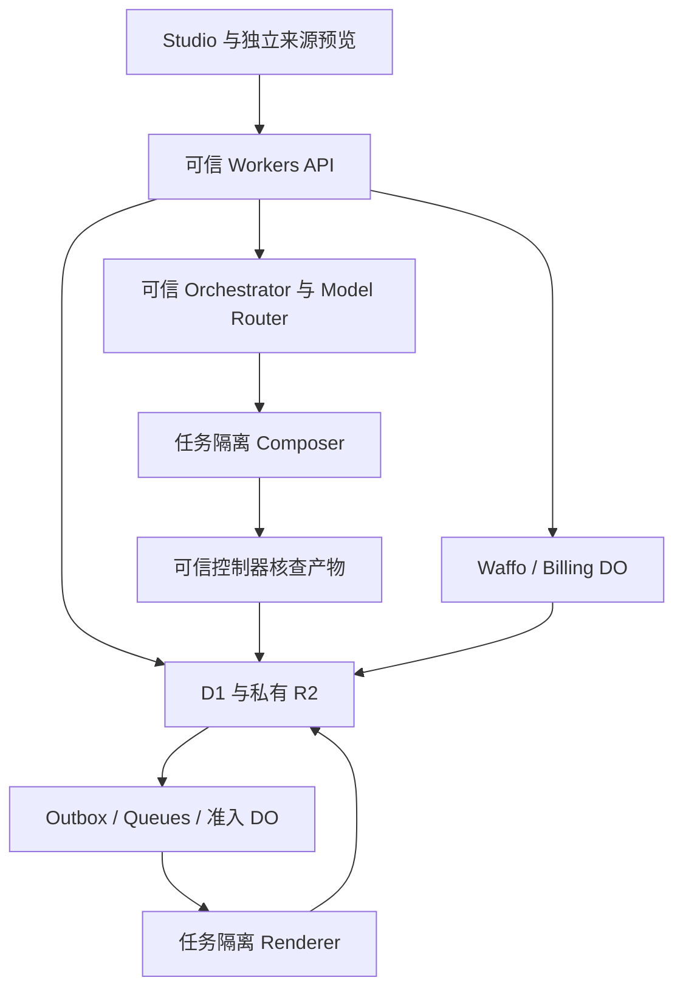

# 技术架构与数据契约

业务 API、鉴权、账务和模型凭据属于可信层；Composition 代码、评论、素材内容与沙箱输出都视为不可信数据。跨模块规则见 [14](14-production-contracts.md)，认证和交易分别见 [12](12-routing-and-auth.md)、[05](05-waffo-billing.md)。

## 1 技术与职责

| 层 | 技术与责任 |
| --- | --- |
| 网站/API | React、TypeScript、React Router/Vite、Cloudflare Workers/Static Assets；SSR、鉴权和协调 |
| UI | Tailwind、shadcn/ui Base UI、Lucide；视觉与交互按 02，语言与主题行为按 10 |
| 状态/文件 | D1 保存业务记录；私有 R2 保存不可变的素材、源码、音轨、帧、输出和必要证据 |
| 调度 | Queues 传递任务，DO 协调并发；事务发件箱 outbox 防漏发，租约与 generation 防止过期任务提交 |
| AI | 一个可信 Orchestrator + 工具 + Model Router；Workers AI 可处理轻量任务，编码模型经真实基准配置 |
| 计算 | Composer/Renderer 独立沙箱，Node/Chromium/FFmpeg/ffprobe；都可能执行不可信代码 |
| 外部业务 | Google OIDC、Cloudflare Email Sending、Waffo；密钥留可信 Worker |
| 工具/观测 | mise、pnpm、精确锁文件，脱敏 Logs/Analytics，Access + 应用 admin |

不另引入数据库/部署厂商；Workers HTTP 只协调，不承担长时间 Chromium 或模型编排。创作、素材处理、预览和交付各自返回持久任务 ID，浏览器轮询不能成为交付依赖。

## 2 素材、源码和数据发送

准入来自 01 和 [输入配置](../../config/input-capabilities.json)。上传、解码、素材理解和方向生成前必须登录，且当前项目有已绑定试用或有效付费处理权益；无资助的新草稿不得先消耗这些云资源。检验魔数/解码而非扩展名，限制文件大小、像素、时长、线程和内存；图片方向/色彩规范化，音频规范化 48 kHz。录屏可以生成 H.264 预览代理，但必须先验证目标 Chromium 构建支持的解码器；不支持则用经过验证的预览抽帧，不能假设开源 Chromium 自带 H.264/AAC 解码。正式 Renderer 对实际使用的视频区间默认以 FFmpeg 按 PTS 确定性抽帧并复用受限缓存（含变帧率），不是无条件抽取所有上传帧；缺帧、PTS 不连续或资源越界明确失败。原始媒体与规范化 asset_version 都不可变。用户上传 HTML/SVG 与 Agent 在沙箱编写 HTML/SVG 严格区分。

上传 intent 收取用途、文件名、媒体类型、预先计算的 SHA-256、字节数及 `rightsDeclaration`。声明列明告知版本、owned/licensed 依据、处理/预览/商用范围、人物权利与限制；服务端记录声明人和时间，绑定 workspace/project、来源 hash/长度、临时 key 和截止。文件名仅作显示，不生成存储路径。声明是保存的依据，不自动证明真实授权；首次处理前执行 09/14 的用途准入，免费预览同样适用。

complete 只收 `requestId/uploadId`，服务端比对 intent 与实收字节、hash、魔数及对应用途的格式边界；不匹配返回 422，不创建可用版本或启动后续模型处理。重试复用原结果，正式素材及规范化版本不可变。`purpose=evidence` 另允许 PDF，按输入配置的 `evidence_documents` 独立数量、单文件和项目总量检查，不占视觉素材或音视频处理次数；仍须权限、权利声明和存储预算。图片及音视频证据继续使用对应的格式、处理预算和限制。全部证据只供事实/权利核查，不执行脚本、不进入可绘资源清单，也不满足创作必需的视觉素材。账号、项目和素材归属取数据库，不信客户端自报。

只向已批准 provider 发送该用途所需的最小任务数据，如素材摘要、必要帧、转写所需音频或改稿涉及的源码片段，记录用途、provider 和数据范围；具体数据处理、日志与保留规则见本章第 6 节。

### 作品版本与预览

作品统一保存在 `project_revisions`。每个版本的 CompositionManifest 固定源码、依赖、素材、布局、事实和音轨；检查报告与用户复核记录单独保存。版本、摘要、全目标冻结和资源准备的完整规则见[14](14-production-contracts.md#2-manifest目标与冻结准备)。品牌 `fontSelection` 只能引用已审核的平台字库、版本与回退，未选择时为 null，不能假定客户设备上的字体可用于渲染。

已获准本地执行的完整预览使用基线版本的 runtime、源包、字体与音轨；未保存参数立即在本地显示，保存时才通过 CAS 生成新版本。具体预览状态、缩放与正式捕获边界见 [14](14-production-contracts.md#5-renderprotocol)，本地执行的输出审核条件见下文。自动保存不触发模型、云 QA 或编码。可信截图/片段、预检和目标准备由明确操作发起，分别检查权益、缓存与费用预算。

内容变化后，服务端重新计算当前稿的检查资格，允许相同输入复用有效报告并建立新版本关联；不能由客户端修改报告，也不能沿用不再匹配的通过结果。原购买快照保持不变。网站主题、Cookie 和浏览器语言不改变作品。

### 可选提示审核

[内容审核配置](../../config/content-safety.json)提供可选的 Waffo Prompt Sift，默认关闭，开关和凭据只在可信后台。`creative_generate`、`agent_patch`、`prepare_targets` 中每次产生新内容的模型调用，在发送前审核；纯编码、已审核内容的重放和自动保存不重复扫描。

选用该提供方时，可信编排器用 `generationScanInputForRequest` 映射业务请求，再由 `generationScanInput` 组装本次任务、用户指令、事实文字（含相关素材提取文字）、转写、批注和实际参与生成的可编辑文本。无独立 instruction 的批注改稿和目标准备不伪造指令；至少一项须有实际内容。固定 JSON 结构保留原文与次序，不发送整仓源码、二进制附件、支付资料、固定系统提示或凭据。结果绑定 operationId、generationId 和完整送审文本；输入或生成调用变化不能沿用旧结果。

组装和长度预检在排队、次数及费用预留前执行。`generationScanBudget` 的 `sections` 和 `textCodePoints` 统计原文，`formatCodePoints` 统计字段、标点与转义开销；二者之和等于实际发送的规范 JSON 总长 `totalCodePoints`。它只返回数字，空段原文用量为 0。上限取 `content-safety.maxPromptCharacters`，按 Unicode code point 计数；提供方具体计数边界仍待实测。这只限制本次选中且实际交给模型的生成上下文，不限制项目保存容量，也不替代模型上下文限制或美元预算。超限返回 422 `PROMPT_TOO_LONG` 并保留原稿，提示缩小本次材料范围；不静默截断、摘要或丢弃已选文字，错误和日志不回传原文。实际界面与服务仍需接入。

启用时使用 `semantic=enforce`，只有有效的 allow 且语义评分确实执行，`providerAllowsGeneration` 才为 true。关闭时返回 `provider_disabled` 和 false，表示该提供方未给出审核许可；总流程须取得当前审核方案的有效通过结果，不能把关闭 Waffo 当作整体放行或固定拒绝。review、block、降级、未知响应及超时均不能冒充通过。重试、超时和限流取配置及参考适配器，所有调用共用原操作预算。

Prompt Sift 只覆盖输入审核。审核日志只留 requestId、判定、理由、输入摘要及必要任务引用，访问和保留按第 6 节执行。当前参考适配与本地测试不代表真实调用、人工处理或两阶段审核已上线；来源和披露见 [09](09-sources-and-licensing.md#34-waffo-内容审核要求)。

### 输出审核

方向卡、Treatment 和 audioPlan 在展示前审核实际文字；`run_result.outputStatus` 只有为 `allowed` 时才可返回这些字段，审核中或扣留时不能夹带原文。候选、可信预览、导出和案例展示分别审核实际可见文字、画面与音频，不能用源码声明或少数封面代替动态内容。

可信服务保存 `outputSafetyResult`，绑定项目、operation/revision、用途、实际 `subjectHash`、`targetId`、策略、检查表示和 `coverageManifestHash`。覆盖清单固定实际文字摘要、源片范围、帧数、受检帧与连续音频区间；最低采样由登记的策略推导，不能靠调用方缩短采样数组放行。具体字段与边界见 [14](14-production-contracts.md#8-事实与qa授权)。媒体回执从可信 `outputSafetyResults` 按 artifact.id、screenshotAssetId 或 clipAssetId 取回，任务由同键 `outputOperationIds` 绑定，未登记时只能匹配 null。截图/封面检查文字与画面，视频/片段还检查覆盖实际输出时长的音频。

纯图形与无音轨作品须由可信检查生成 `outputSafetyModalityObservation`，记录同一对象、目标及表示下的 `textPresent`、`audioPresent` 和证据引用；其摘要由覆盖清单的 `modalityObservationHash` 固定。只有观察确认确实不存在相应内容，才允许文字或音频清单为空；缺观察、摘要不符或实际存在但未覆盖都拒绝。静音作品保留真实时长，不为通过审核伪造音轨或摘要。

只有 `allowed` 且内容、用途、目标、策略和覆盖均匹配时可放行；控制器必须提供可信 `revokedResultIds`，缺失或已撤销均拒绝。相同不可变内容不设置统一重扫天数；跨 operation/revision 复用时，仍须由可信服务建立绑定当前用途的 association 并重验上述条件。内容或所需策略/覆盖变化不能沿用旧结果，策略版本不进入创作 contentHash。`outputSafetyErrors` 只做参考准入校验，不产生真实审核结论。审核状态独立于美学 QA，普通 REVIEW 的用户确认不能豁免安全阻断；未通过的候选保持 withheld，不展示或消费可用结果次数，复核与修复共用原预算，实际费用照记。

审核表示分为 `text`、`trusted_media`、`verified_local_runtime`。已检查的可信视频不自动授权任意本地源码执行；本地回放须验证受限 runtime、资源和全部可触达状态，并绑定 `runtimeStateHash`。能力和覆盖尚未验证时，对外只提供已审核的可信媒体。普通输入和自动保存不逐键触发云审核；保存不代表取得展示许可，新内容在可信预览、冻结、分享或导出前须取得匹配结果。

真实审核提供方、覆盖策略、申诉处理和上述展示门禁须在开放客户生成前接通并实测；内部可信样片和参考测试不解除此门槛。

## 3 队列、资源与隔离

业务更新与 outbox 在同一 D1 原子批次提交；dispatcher/Cron 扫描漏发，不能只依赖进程内 waitUntil。Queues 可能重复投递，重复消息复用同一 job；提交结果时校验 generation，拒绝已取消或过期的任务。Billing DO 按项目协调 checkout、grant、快照预留、退款冻结和首次发布；网络等待后重新读取权威状态。

成功结果持久化后 ack；可恢复失败先原子写 attempt 和定时重试 outbox 再 ack；持久化失败不 ack。重试由一套应用调度控制，不同时叠加 Queue 重投与应用重试次数。渲染最多 3 次实际执行，退避 15/60 秒；模型内部修复最多 2 轮，累计预算共享。无效素材、未确认事实、确定性违规不盲重试。

[算力配置](../../config/agent-policy.json) 的全局 4 个物理容器覆盖素材、Composer、预览、音频、QA、Renderer 全部类别；工作区最多 2，创作/渲染各 1。子工具复用同容器令牌或另申请，不能持有全部令牌等子任务造成死锁。等待用户/预算暂停释放容器，已收款任务有预留容量和优先级。单次尝试、心跳与无心跳核查期限取配置；硬超时不是公开 SLA。

Composer/Renderer 都按 job/generation 隔离，结束销毁；不复用含客户源码、内存或文件的长期进程。实例是信任边界，不以不同 Linux 用户冒充隔离。默认禁公网，不携带支付、模型、D1/R2 管理或云平台凭据；资产代理只给当前任务的只读输入与有限输出。依赖离线镜像、锁定和许可审核，禁止未审查生命周期脚本。

不信源码自报 QA。预览使用独立 origin、无主站 Cookie、CSP/iframe 限权，bridge 校验 origin/source/nonce/session/schema；具体按 14。普通退出不取消已付款渲染，成员撤销/项目墓碑阻止未提交创作副作用。M0b 在真实 Cloudflare 验字体、视频 seek、WebGL 能力、编码、销毁重建和跨任务残留；本地 PoC 不替代。

## 4 实体与原子性

身份：users、auth_identities、auth_flows、auth_action_intents、email_challenges、sessions；工作区：workspaces、memberships、invites。证明、identity 唯一性、登录恢复按 12。D1 查询显式限定租户，不依赖自动 RLS。

试用：`trial_claims` 以内部 user_id 和 trial_project_id 分别唯一，保存 workspace_id、claimed_at 和政策版本。Owner 自领、项目创建、claim/grant 同事务；requestId 重试返回同项目，并发最多成功一次。`requestTrial` 默认 false；创建响应的 `trialGrantStatus` 使用 not_requested/granted/unavailable，不可领取仍可建无权益草稿。项目响应的 `trialStatus` 中 active 表示已授予且仍在正常试用期，expired 表示该期限已过，not_granted 表示本项目未获授；次数余额独立计算，用完次数不把期限改成 expired。身份或项目变化不重置 claim，最小去重关系按第 6 节保留；资格、次数和使用范围统一见 05/12。

内容：projects、product_facts、assets/asset_versions/asset_refs、upload_intents/rights_declarations、asset_transcripts、project_revisions、composition_sources/variants、creative_briefs/treatments、agent_runs/agent_run_steps、agent_candidates/agent_patches、fact_manifests、quality_reports/quality_associations/quality_waivers、output_safety_results、comments/edit_requests；独立展示授权为 showcase_consents。QA 和输出审核各自绑定精确内容与策略，不修改创作内容；字段及状态见 14。可无 scene/element 标记，不强制场景结构。

交易：orders、checkout_disclosures/checkout_consent_receipts、active_checkout_slots、entitlement_grants、credit_reservations/credit_ledger、payment_inbox、refund_requests、export_snapshots/export_releases/export_artifacts、jobs/job_attempts、outbox、renderer_versions。creative_reservations/creative_ledger 与成片账本分开。按 05 的购买资格、项目初始槽/升级槽、依赖退款与重新购买条件建唯一约束；条件写和 outbox 同事务，不无条件读后减余额。消费与费用不能因退款改写，旧付款去重关系不能被新订单复用；保存范围和期限见第 6 节。

货币使用整数最小单位，模型费用使用整数 USD micros；provider 单位由 adapter 明确转换。时间 UTC，UI 未知时区先标明 UTC，hydration 后可调整显示，但不改已确认的视频日期。素材、源码、事实、声音和 QA 构成引用图，清理必须先检查在途任务及有效购买。

### 成本计量与归因

从 M0a 开始按 Schema 的 `costEvent` 记录费用；尚无 D1 时用相同结构的 JSONL。金额、费用预留、去重和估算/实收的替代关系统一按[14 费用规则](14-production-contracts.md#6-ai操作费用与成功次数)，不要另写一套算法。

每条记录从可信作业取得用户、工作区、项目、operation、attempt 和 target，注明用途、供应商/模型、价格版本及原始用量单位。记录能测到的 tokens、CPU、内存、存储与请求费用；未知用量标为未知，不能填零。原币金额与换算依据随提供方记录保存，不记录提示全文、凭据或客户源码。

独立容器费用归实际持有任务；公共闲置、固定服务费与无法精确归属项记 scope=shared，按说明的方式分摊，不伪造逐调用精度。R2 按 operation/attempt/类别批量计量，不为每次读写同步写一条 D1；按供应商账单复核总量。多个逻辑 target 复用一个物理文件只记一次生产费用，分摊权重和为 1；缓存命中也计实际读取费用。落库时保证观察去重及替代关系单一，不因并发结算重复累计同一成本项。

预算数值取 agent-policy，未标定前保持关闭；已付履约保障按 [05](05-waffo-billing.md#10-创作次数与履约保障)，成本分组与经营统计按 [07](07-growth-and-experiments.md)。

## 5 第一方 API

URI 和权限以 [路由配置](../../config/routes.json) 为唯一注册来源；关键请求/响应在 [API 契约](../../contracts/agent-api.json) 引用 [正式 Schema](../../contracts/production.schema.json)。已绑定对象使用封闭字段和明确分支；其余 API 在对应模块实施前补齐契约与负例，不能接受任意 object 代替。下表按模块说明实施责任；当前 API 尚未部署。

普通业务写请求使用 requestId/Idempotency-Key，同时提供须一致；幂等范围包含 workspace/project/actor/route，请求摘要不一致返回 409。认证、外部回调的例外按 12/05，不把普通幂等缓存用于绕过 OTP 限次。Origin/CSRF、资源权限和生命周期在副作用前校验。无会话 401、已知角色不足 403、不可见资源 404、输入 422、限流 429；未知路径 404、方法 405+Allow。错误外壳为 code/messageKey/安全 params/message/fieldErrors/retryable/requestId。

| 模块 | 实施重点 | 规则来源 |
| --- | --- | --- |
| 登录与偏好 | Google、邮箱、关联、重新认证、会话和主题偏好 | [12 认证](12-routing-and-auth.md)、[10 语言与主题](10-i18n-and-themes.md) |
| 工作区与成员 | 当前成员查询、Owner 管理、邀请、所有权转让和删除；写操作校验当前版本 | [12 权限](12-routing-and-auth.md)、本章删除规则 |
| 项目与草稿 | 建项目/申请试用、读取可用操作、保存/恢复、复制和删除 | [14 版本模型](14-production-contracts.md#1-唯一版本模型)、[05 权益](05-waffo-billing.md) |
| 素材与事实 | 上传授权、完成核验、事实编辑/确认、转写确认 | 本章第 2 节及下方接口语义 |
| 创作与预览 | 创作/目标准备、进度、恢复/取消、本地回放、可信截图/片段、多批注改稿与候选接受/拒绝 | [14 操作与状态](14-production-contracts.md#6-ai操作费用与成功次数) |
| 检查与导出 | 预检、质量报告、全目标快照、首批导出、补平台和下载授权 | [14 冻结与交付](14-production-contracts.md#4-snapshotrelease与账务身份) |
| 订单与支持 | checkout、Waffo 回调、订单查询、退款申请 | [05 交易](05-waffo-billing.md) |
| 分享与展示 | 只读审阅链接、普通评论、独立案例展示授权和撤回 | [12 审阅权限](12-routing-and-auth.md)、本章第 6 节 |

完整方法、路径和最低角色只在 routes 登记，请求/响应定义只在 agent-api 绑定 Schema，不在文档再维护一份路由表。

项目复制只继承同工作区内获准的素材与源包引用。新项目没有试用或付费权益，原购买快照与 QA 授权也不转移；可查看和本地编辑，新增上传、云预览、QA 或创作前先购买 `project_pack` 的 `top_up_only` 权益。

取消 run 或拒绝候选要核对请求 base 与该 run/候选的 base，但不要求它仍是当前草稿；接受候选才要求当前草稿的 CAS。`jobs.get` 仅返回素材处理状态及 asset 引用；run、preview、export 各查自身持久资源，按任务能力返回真实阶段、进度、安全错误码和可否重试，未知进度明确标为未知。项目的活动任务与待接受候选引用用于刷新恢复，不依赖浏览器内存。

审阅 token 只经专用 loader 读取限定版本的预览，不调用成员全量接口。`comments.create` 保存普通讨论，不触发收费 AI；本地待提交批注经保存和版本确认后，成组提交 `edit_requests` 才发起改稿。金额、provider、回跳 origin、目标宽高、预算或权限不接受客户端任意覆盖。

### 关键接口语义

路径 ID 与 body ID 必须相等；所有引用重新查验当前租户、项目、成员和生命周期。读接口无业务副作用，均 `private, no-store`。Schema 只校验结构，不能替代以下服务端判断：

- **付款与上传授权。** `checkoutResult` 只返回本地 orderId、订单/会话状态和受控 URL/截止，不透传提供方对象。只有 ready 会话有 HTTPS checkoutUrl；pending/closed 均为 null，pending 不另开付款会话。服务端核对实际会话、允许的提供方主机和有效截止，禁止凭 HTTPS 字符串放行任意地址。上传 URL 同样只授权该 intent 的临时对象、PUT、长度/类型及期限；complete 再检查当前权限与实际字节，处理预算和费用不因重试重置。
- **事实编辑与确认。** `changes[].expectedVersion` 对应每项 `recordVersion`，0 仅创建从未使用的 factId；编辑或确认状态改变时递增记录版本。`version` 仅在正文改变时递增，用于防止陈旧确认，不进入计费身份。`textHash=digest(text)` 计算 JCS 字符串字节，包含 JSON 双引号；不是原文 UTF-8 的直接摘要。证据变化使受影响的当前确认和检查资格失效，不改变计费内容或旧快照证据。批内 factId 唯一，CAS 全部原子通过，移除不破坏旧快照。正文变化按 14 同步参数、绑定和新 revision，响应给出新建及当前版本引用；仅确认不改 Composition。确认同时匹配 factId/version/textHash/expectedRecordVersion，确认人和时间取有效会话及服务端，Agent 不能代确认。
- **证据与转写。** 事实的 `evidence` 只提交 assetId/sourceHash；服务端核验该项目已完成的 evidence 上传，并生成绑定来源字节及当前文案 hash 的 evidenceRefs。14 的事实分类及来源要求仍适用，客户确认不自动证明真实性。转写绑定不可变 assetId/sourceHash，expectedVersion=0 为首次，其后匹配当前转写版本；各段按时间升序、不重叠、落在实测时长内，合计原文不超过 6000 Unicode 码点。商业声称关联当前已确认的 factId/version/textHash，并接受文本覆盖检查；空 facts 不能绕过声称检查。`transcriptHash=digest({assetId,sourceHash,segments})`，确认人/时间由服务端写入；来源或事实变化须重新确认受影响的转写。
- **展示与退款。** 展示 grant 必须当前 Owner、有权许可、已交付且确属该项目的 release、告知版本及明确所选渠道；scope 仅为该成片的 product_showcase，不延伸到原始素材或训练。revoke 使用当前版本，不要求仍有创作额度或媒体处于可编辑期，立即停止新增使用并安排撤下受控展示；旧 grant 的重放不能恢复已撤回授权。普通支持的可选 project/order 必须可见且关联一致；refund 分支额外核验订单 Owner，按 05 进入退款申请及依赖核查，不接受客户端金额/权益，不把 requested 当作退款到账。

持久 export/snapshot GET 只返回授权范围的清单元数据，不生成媒体授权、不延长期限，也不恢复已撤销的交付权益。短期文件授权仍由 downloads 接口按当前订单、release 和项目生命周期单独签发。

## 6 隐私、保存与删除

对外 [Privacy 正文](../../content/pages/en/privacy.md)须与本章及实际数据流一致；供应商、期限、展示副本和跨境等待补事实集中见[内容维护](../../content/pages/README.md#6-发布前待确认与核验)，未知项不以模板猜测值代替。

### 数据角色与处理范围

按实际活动判断责任：账号、安全、反滥用和经营分析由平台决定其处理目的；客户为制作任务提供的个人信息通常由客户决定用途、平台按约处理。Cloudflare、模型和其他分包方分别列入处理链；Waffo 的销售、支付及合规责任按实际合同判断，不能把所有第三方统一称为平台的处理者。上线前明确适用的数据处理协议、子处理者授权/变更告知及异议渠道、跨境传输安排和事件响应责任；法律依据见 [09](09-sources-and-licensing.md)。

不以客户素材、提示、源码、声音或成片训练模型，不跨工作区复用私有创作资料。P0 不提供训练授权开关。供应商的合同和账户设置必须支持此承诺，不满足时不接入。工作区偏好只用于该工作区；分享审阅不构成公开展示同意。

案例展示单独征求默认未选、具体且可撤回的同意；当前仅可选择已交付 release 及 website_examples/social_media/advertising 渠道，不包含原始素材或训练。记录用途、告知版本、授权人及同意/撤回时间，核对其有权许可该范围。拒绝不影响制作、付款或下载。撤回后停止新增使用并从平台控制的展示页面/投放素材撤下；第三方已转发或下载副本的实际限制在同意时说明，不承诺删除整个互联网。撤回展示、删除项目和退款分别处理，保留必要的同意/撤回证明不等于继续公开作品。

不用于训练不等于零保留。选定模型、转写或审核服务前核实合同、账户设置、用途、区域、保留期限和删除能力，写入 Privacy。自托管转写仍涉及云基础设施，文本交给模型时也计入数据处理范围。常规日志只记录必要的状态、用量和受控引用，不保存客户全文、原始媒体、私有源码、访问令牌或提示全文。

### 隔离、缓存与公开标记

私有素材缓存键至少包含 workspace、输入字节 hash、处理器版本和参数；命中后仍核验当前项目的素材引用、用途和处理权益，不能用另一租户的 hash 命中绕过授权或透露其素材存在。客户私有缓存与经过许可的平台公共资源缓存分开管理。复制项目只继承获准引用，不复制授权范围或赠送新处理额度。

对外 AI 标记只包含履行披露所需的最小信息；客户身份、提示、私有素材 URL 和权利证明原文不随 C2PA/媒体元数据公开。受控权利记录、事实证据和最终文件标记的绑定按 14 校验。

### 生命周期与删除

项目正常保存期、续期和只读宽限统一按 05。主动删除立即设置墓碑，撤销分享和新下载授权，取消任务；在 [agent-policy](../../config/agent-policy.json) 的 `retention.onlineMediaDeletionHours` 时限内清理本服务在线业务存储中已无合法引用的媒体。迟到结果进入孤儿回收，不复活项目；暂存期和退款宽限不能延长用户主动删除时限。活动引用须属于仍有依据的任务/项目，不能用无期限“审计需要”保留全部素材。

备份、供应方日志和灾备副本按实际合同与恢复机制分别设定可核验的清除周期，上线前列入保留表和删除演练；在线媒体的清理时限不代表所有第三方副本的删除期限。恢复备份时重放删除墓碑，防止数据重新开放。

订单对账、付款去重、防重复试用、争议与许可证明仅保留所需最小字段、条款/同意版本、授权记录和必要输出 hash，分别注明目的、访问权限、期限或终止条件；可用最小证明完成目的时，不持续保存完整源码、录屏或成片。退款不改写消费和费用历史，但个人信息仍遵守对应保存/删除要求。

数据访问、更正、导出和删除请求通过已提供的设置或支持渠道受理，核实主体与租户权限。P0 账号关闭统一通过 `brand.supportEmail` 人工受理，身份、账号控制权及关闭意愿的核验、工作区/订单处理和会话撤销按[12 §6](12-routing-and-auth.md#6-googlesession-与敏感操作)执行。关闭不等于退款；文件删除、到期和已取得的成片使用权分别按 05 处理。

## 7 发布隔离

生产和预发布 D1/R2/Queues/DO/支付配置/密钥独立。认证和个性化 HTML/API no-store，绕过共享缓存；仅公共静态内容可 CDN 缓存。renderer 注册表保存真实可执行应用/镜像/runtime/资源绑定，保留到有效引用结束；新部署不改变已购快照，安全修复使用审计更正版。发布/回滚不能删除订单或误报外部验证成功。
