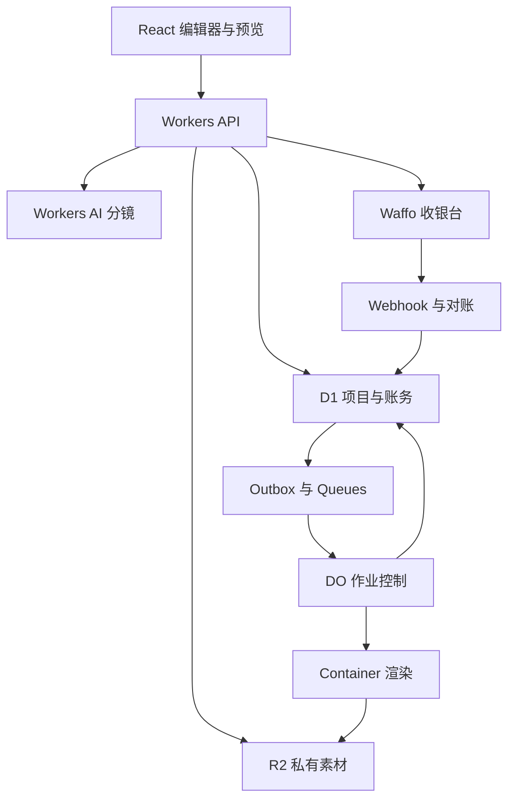

# 技术架构与数据契约

## 1 固定技术路线

| 层 | 技术选择 | 职责 |
| --- | --- | --- |
| 开发语言 | TypeScript，React | Web 界面、共享场景模型、API 与作业控制 |
| Web 框架 | React Router Framework，Vite，Cloudflare Vite plugin | SSR 公开页面、应用路由、Workers 本地开发 |
| 样式与组件 | Tailwind CSS、shadcn/ui 的 Base UI 版本、lucide-react；衬线展示字体与无衬线正文/控件字体 | 统一 UI 源码与语义 tokens；系统字体栈、杂志排版与专业工具配色见 [11](11-ui-design-spec.md) |
| 国际化 | i18next、react-i18next、Intl、集中英文网站资源 | 请求级 UI 上下文、复数、插值、格式化；网站首发仅 en |
| 明暗主题 | CSS 自定义属性、data-theme、prefers-color-scheme、Cookie | 默认 System；单图标切换并记住 Light / Dark，设置可恢复 System；与视频样式隔离 |
| 依赖管理 | mise、pnpm、精确锁文件 | 开发与 CI 工具链可复现；容器按自身运行环境锁定，版本选择遵循部署兼容策略 |
| Web 与 API | Cloudflare Workers 和 Static Assets | 页面、鉴权、项目、计费、资源授权 |
| 业务数据库 | Cloudflare D1 | 用户、项目、订单、版本、权益、任务、事件 |
| 文件 | Cloudflare R2 私有桶 | 原始上传、规范化素材、成片、封面、归档 |
| 调度 | Cloudflare Queues | 素材处理和成片作业的至少一次投递 |
| 任务与账务协调 | Durable Objects | 作业租约、恢复、资源准入，以及按项目协调 checkout、额度、退款和交付 |
| 渲染计算 | Cloudflare Containers | Linux、Node、Chromium、FFmpeg、ffprobe |
| 内容 AI | Cloudflare Workers AI | 仅处理已确认文本与结构化分镜 |
| 认证邮件 | Cloudflare Email Service 的 Email Sending、Workers binding | 英语验证码邮件；Workers Paid、发信域名与真实送达按 [12](12-routing-and-auth.md) 验收，官方当前为 Beta |
| 防滥用 | Turnstile、Workers 限流、服务端配额 | 注册、上传和 AI 成本控制 |
| 观测 | Workers Logs、Analytics Engine、D1 关键事件 | 技术故障、业务漏斗与成本 |
| 内部后台 | Cloudflare Access 与应用管理员权限 | 运营、退款处理和故障恢复 |
| 支付外部服务 | Waffo.ai | 托管收银台、服务端付款、退款及对账 |
| 登录身份 | Google OIDC 与邮箱一次性验证码 | 共用内部 user、可撤销会话与业务授权；两种方式按 [12](12-routing-and-auth.md) 显式关联 |

Cloudflare 官方提供 React Router SSR 与 Vite 集成；实施阶段从其当前官方模板初始化并锁定兼容版本，不使用过时的框架主版本猜测。[官方框架说明](https://developers.cloudflare.com/workers/framework-guides/web-apps/react-router/)

P0 不额外引入 Supabase、Vercel、Redis、独立云厂商、Vectorize 或 Workflows。Queues 与 DO 足以描述此版可恢复任务；如果后续出现多天人工审批链，再单独评估编排服务。

## 2 架构与职责

业务入口提交任务后立即返回任务 ID。浏览器轮询任务状态，间隔从 2 秒逐渐增至 10 秒，后台标签页降低频率；可在以后升级 SSE，不依赖长连接保证交付。Workers HTTP 请求不承担 Chromium 渲染或 FFmpeg 编码。

D1 保存业务结果，DO 负责某个作业的当前执行，容器只是可丢弃计算环境。任何成片或订单都不能只存在进程内存或临时磁盘。

## 3 与 huashu 仓库的关系

本轮阅读的 huashu-motion 基线提交为 `3e927801e78b587878fb7dbb65d616326df00c21`，package.json 版本为 0.1.0。上游是本地 coding agent 工作流，不包含本 PRD 的多租户、计费、云作业和账户系统。参考其导演流程、分镜组织、素材定位、局部编辑思路与按时间渲染方法，选择性移植适用的 MIT 代码并保留来源。

P0 成片使用自有 React 场景组件和纯时间函数。上游的 CLI、不受限 agent 执行、macOS 配音路径不作为生产服务的默认执行入口。huashu-art-motion 的参数化图形与高亮场景可作为后续组件来源，首版只接实际用得上的已核查组件，不导入全部艺术样例。

必须遵守上游第三方清单：项目自身代码及文档的 MIT 不覆盖所有附带资产；GSAP 有单独许可，作者“豆子花叔”形象不授权用作本产品素材。P0 默认不打包 GSAP，以自有插值和 SVG、Canvas、DOM 绘制实现指定动效；如将来采用 GSAP，需先确认具体使用获得相应许可。此决定不等于宣称所有商业 GSAP 用途被禁止。

来源：[上游提交](https://github.com/alchaincyf/huashu-motion/commit/3e927801e78b587878fb7dbb65d616326df00c21)、[第三方清单](https://github.com/alchaincyf/huashu-motion/blob/3e927801e78b587878fb7dbb65d616326df00c21/THIRD_PARTY.md)、[GSAP 官方条款](https://gsap.com/community/standard-license/)。

## 4 素材处理

### 4.1 P0 支持范围

| 类型 | 输入 | 限制与处理 |
| --- | --- | --- |
| 图片 | PNG、JPEG、静态 WebP | 单文件最多 10 MiB，解码最多 16 MP；统一方向、色彩和元信息 |
| Logo | PNG、静态 WebP | 另设 1 个 Logo；保留透明度，最多 5 MiB |
| 视频 | MP4 或 MOV 中的 H.264；WebM 中的 VP8 或 VP9 | 单文件最多 50 MiB、60 秒，最大边 4,096 px、总像素 8.3 MP、帧率不超过 60；最多 3 段，总时长 180 秒；转为规范化 H.264 代理 |
| 音频 | MP3、WAV、M4A 中的 AAC | 旁白和配乐各 1 条，单文件最多 10 MiB、60 秒；规范化至 48 kHz |
| 文本 | 用户表单及粘贴销售文案 | 最多 6,000 字符；转为明确事实字段与普通文本 |

一个项目最多 12 个视觉素材，其中含视频，另加 Logo 和两条音轨；总上传体积上限 200 MiB。HEVC、ProRes、动态图片、任意 SVG、HTML、PDF、PPT 不是 P0 输入，错误提示写明实际编码范围。以上范围需通过容器真实样本测试才能在上传器宣布支持。

免费账号累计成功规范化最多 6 段视频、360 秒；每次付费项目包或追加包为对应项目增加 20 段、1,200 秒素材处理预算。两种限额同时满足才能处理。相同内容 hash 的同权限素材复用不重复处理，用户删除文件或新建工作区不重置免费累计配额。该限制是后台成本护栏，在即将耗尽时给予明确提示。

### 4.2 上传到不可变素材

1. 用户请求上传意图。Worker 检查登录、工作区、文件声明、剩余配额，分配只对应一个对象键的短时上传权限。
2. 直接上传到 R2 的临时 upload key；较大文件支持断点或 multipart，上传授权不允许列举桶。
3. 完成接口核验实际体积、magic bytes、hash、尺寸、时长和编码，不能信任扩展名和客户端字段。
4. 素材队列在隔离容器处理，写入新的规范化私有对象键并计算最终 hash。
5. 服务端发布不可变 `asset_version`，预览与导出仅引用这个版本；原上传 URL 即使仍有效也不能覆盖已确认素材。

R2 预签名地址是到期前可使用的 bearer token；不能把临时可写对象直接当已冻结视频素材。[R2 官方说明](https://developers.cloudflare.com/r2/api/s3/presigned-urls/)

删除与过期清理由素材引用关系决定。被另一有效项目或已导出版本引用的规范化对象不能提前删除；跨工作区不做可泄露存在性的全局去重。

## 5 场景与渲染

### 5.1 结构化契约

SceneDocument 包含 schema 版本、可选内容语言元数据、品牌快照、事实引用、素材版本、帧率、总帧数、随机 seed、场景和四种构图布局。场景类型固定为 `hook`、`product_showcase`、`screen_demo`、`benefit`、`facts`、`cta`。

`language` 仅作为可选内容元数据，与网站 `uiLocale` 分离；未知可用 `und`，多语内容可用 `mul`，不要求用户选择，也不限制文案准入。实际用于排版的语言、方向及文字随 revision 和内容快照固定，重试时不重新识别。页面的 `themePreference` 与 `uiLocale` 不进入 SceneDocument，也不参与导出版本身份。`brand` 保存客户产品品牌；平台的 PromoBento 标识与公开预览水印独立配置，不能批量覆盖客户名称、CTA 或颜色。

每个 scene 必须有 `id`、`type`、`startFrame`、`durationFrames`、`text`、`factRefs`、`assetRefs`、`layoutByAspect`。时间使用整数帧，素材裁切使用 0–1 归一化坐标。资产引用不包含外部任意 URL；文本是普通字符串，不能渲染为 HTML。

scene 可按已有 `text` 字段名提供可选 `textMetadata`，覆盖语言和方向；混排不需要统一成单一项目语言。缺少语言元数据或识别失败不阻止生成、编辑、预览和导出；最终使用的文本方向与字体随快照固定。

详细例子见 `contracts/scene.example.json`。英语与 Inter 只是该示例的值，不是全局允许范围。类型、长度、范围与引用完整性同时在前端和服务端校验，服务端为最终依据。模型产生的未知类型、未知字段、未确认事实、不可访问 asset ID 必须拒绝，不能宽松合并进项目。

### 5.2 共享渲染

预览与编码导出共用同一个 `scene-renderer` 包：`renderFrame(document, frameIndex, aspect)` 的视觉结果取决于不可变文档和帧序号。动画使用纯插值，不依赖真实时钟、网络返回、鼠标状态或未保存随机数。P0 以 DOM、SVG 与 Canvas 为主，不依赖 GPU 或复杂 Three.js 场景。

字体及回退顺序由受控资源固定，预览和容器加载同一组所需文件，不依赖客户设备的系统字体。字体加载、图片解码和视频 seek 完成后才认定帧就绪，另查实际缺字、复杂塑形、混排方向和溢出。播放页面和渲染页面使用同一基准逻辑。测试比较关键帧、布局、文字、时长和声音，不承诺所有用户浏览器与容器逐像素一致。

完整渲染逐帧向 FFmpeg 管道输出，按构图顺序处理，不将全部原始帧积存在内存或磁盘。视频片段按目标帧 seek 或使用确定性预解码策略；任何策略必须通过实际录屏音视频对齐验收。

音频处理使用同一时序与混音定义。旁白和配乐的增益、淡入淡出、ducking 区间在文档中冻结；导出用 FFmpeg 显式混音，预览使用相同参数。产品音量目标为整片约 -16 LUFS、true peak 不高于 -1 dBTP；这是内部听感目标，不是平台统一硬性规则。

### 5.3 输出不可变性

创建成片版本时固定内容 revision、视频 language、文本方向、素材 hash、字体文件、四种布局、视频样式、模板版本、renderer 镜像 digest、平台预设版本和音频参数。任何派生文件都只读取这个快照，不再查询当前草稿。renderer 不读取用户 Cookie、系统外观或界面主题变量。

`artifact_fingerprint` 由内容 hash、布局、编码配置和 renderer digest 生成。多个平台的指纹相同可共用文件；不同平台的独立布局改变指纹。重新下载只签发权限，不启动渲染。

`default` 容器调度的镜像属于应用级配置。因此，每个生产 renderer 版本必须有独立、可调用的 Worker/Container 应用，`renderer_versions` 注册表保存版本 ID、镜像 digest、调用绑定、字体与前端资源清单；dispatcher 按快照版本路由。旧应用和资源保留到所有关联项目、宽限期及在途任务结束，不能只存旧 digest 却覆盖唯一可执行应用。

系统兼容性或安全修复产生有审计原因的修复版本，与用户改稿区分。不能继续运行的旧镜像通过有记录的免费兼容迁移处理并验收关键帧，原成片文件仍不可变。客户已经购买的版本不会仅因日常部署自动换成另一种视觉结果。

## 6 Cloudflare 作业机制

Cloudflare Queues 是至少一次投递，必须做业务去重。D1 的 `batch()` 可用于事务性写入，但 D1 不提供本项目可直接依赖的 Supabase 式租户 RLS；服务端每次查询都必须验证 workspace 范围。[Queues](https://developers.cloudflare.com/queues/reference/delivery-guarantees/)、[D1](https://developers.cloudflare.com/d1/worker-api/d1-database/)

### 6.1 提交与运行

API 通过按项目的 Billing DO 协调成片版本、额度预留、首次目标清单和 outbox 的 D1 原子写入。活动 checkout、权益授予、退款冻结和首次交付也必须进入同一协调范围；跨网络等待返回后再次比较状态与 generation，不能假定等待期间状态未变。若没有额度，整个操作不能留下可执行作业。Outbox dispatcher 将 ID 送入队列；成功发送后更新状态，重复发送仍安全。Cron 扫描漏发 outbox，不能仅靠请求结束后的 `waitUntil` 保证交付。

一个 job 处理一个唯一构图和编码指纹，release 聚合多个 job。Queue consumer 调用以 `job_id` 命名的 DO。DO 获取执行租约和准入令牌，确认未完成后启动容器；重复 consumer 只能复用或观察同一执行。成功时持久化结果后 ack；可恢复失败时，原子保存 attempt 结果、下一 attempt 的定时 outbox，再 ack。dispatcher 负责下一次投递，不同时使用另一套 Queue retry 增加实际执行次数。持久化失败则不 ack，允许投递恢复。租约带 generation，旧执行的晚到回调不能覆盖新结果。

初始并发：成片队列 2，素材队列 2，全站同时运行容器最多 4；每工作区同时最多 1 个成片作业。全局准入 DO 以有过期时间的令牌约束两条队列的总并发，不能只各自限流后相加失控。

### 6.2 容器和时间预算

起始容器规格选择 `standard-3`，官方当前规格为 2 vCPU、8 GiB 内存、16 GB 临时磁盘，属于待压测配置。固定镜像与规格使用 `default` 调度策略；不默认依赖仍标 public beta 的 `durable_object` 调度策略。[Containers](https://developers.cloudflare.com/containers/)、[规格](https://developers.cloudflare.com/containers/platform/limits/)、[调度](https://developers.cloudflare.com/containers/configuration/scheduling-policy/)

每个尝试的应用级总运行上限 10 分钟，心跳每 15 秒一次，超过 60 秒无心跳进入核查而非立即双开。官方 Queue consumer wall-clock 上限为 15 分钟，应用预算需留出保存和失败收尾空间。[Queues 限制](https://developers.cloudflare.com/queues/platform/limits/)

容器磁盘为临时工作区，实例可能中断；无固定最大运行时长不等于不会被平台停止。成功文件写 R2，job 和额度状态写 D1，完成后主动销毁容器与临时目录。[容器运行说明](https://developers.cloudflare.com/containers/faq/)

可恢复错误最多自动重试 2 次，总计 3 次实际执行尝试，退避 15 秒和 60 秒，由 `job_attempts` 控制。消息重复投递不增加实际 attempt；应用重试与队列恢复不能相乘。无效素材、未确认事实和确定性布局错误不盲目重试。重试仍使用同一成片版本与同一额度，不创建新订单。超限记录终止失败，写入死信通知 outbox 并进入可见失败状态；队列基础设施自身投递耗尽由独立 DLQ 接收。运营可触发有审计记录的修复。

### 6.3 安全与网络

每个容器一次处理一个租户的一个作业；不接收任意用户代码，不挂载其他租户目录，不接收支付私钥或 Cloudflare 管理密钥。运行用户、目录权限、进程数、内存、输入尺寸和 FFmpeg 线程有上限，拒绝未经模板定义的文件访问。

默认关闭容器公网访问。通过 DO 输入或仅对本作业开放的内部资产代理取得批准素材，结果通过限定输出通道返回。预检必须验证 `enableInternet=false` 等实际配置；仅设置 `deniedHosts` 不能自称所有端口都被阻断。[官方出网说明](https://developers.cloudflare.com/containers/configuration/outbound-traffic/)

登录之外还需要服务端 workspace membership、CSRF 防护、上传 token 范围、短期下载 token 和分享 token 范围检查。私有响应不进入公共缓存。预发布与生产使用独立数据库、桶、队列、DO 命名空间、支付商户配置和密钥。

## 7 核心数据模型

| 实体 | 关键字段 | 约束 |
| --- | --- | --- |
| `users` | id、display_name、ui_locale、status、created_at、session_version | 内部稳定 ID；ui_locale 默认 en；提供方邮箱不作业务主键或账户合并依据 |
| `auth_identities` | id、user_id、provider、subject、provider_email、verified_at | provider+subject 唯一；Google 使用验证过的 issuer/sub，email 使用本系统 OTP 验证的比较 key；禁止自动转移 identity |
| `auth_flows` | id_hash、purpose、return_to、context、expires_at、failed_attempts、proofs、completed_session_id | 绑定短时 host-only Cookie；proof 固定身份/用途/时效，不存原始 Google token；任务来源清洗后保存 |
| `auth_action_intents` | id、user_id、session_id、action、resource、target、request_id、request_digest、flow_id、expires_at、consumed_at | 敏感操作的服务端上下文；再次验证只能完成该操作，proof 消费与业务变更原子提交 |
| `email_challenges` | id、flow_id、email_key、purpose、generation、code_hmac、key_version、expires_at、consumed_at、send_state、request_id | 单次原子消费与限次；重发只废止本 flow 旧码，不重置失败次数；不保存明文码 |
| `sessions` | id、token_hash、user_id、created_at、expires_at、revoked_at、session_version | 高熵不透明 token；仅存 hash，HttpOnly/Secure/host-only Cookie；30 天固定期限，服务端可撤销 |
| `workspaces` | id、name、owner_id、brand_json | 1 位 Owner，最多 3 名成员 |
| `memberships` | workspace_id、user_id、role | 组合唯一，所有业务授权入口使用 |
| `projects` | id、workspace_id、audience_type、language、current_revision、status、expires_at | language 为可选内容元数据，可省略或为 und/mul，无用户选择前置条件；统一软删与过期状态，不跨租户关联 |
| `product_facts` | project_id、fact_id、value、confirmed_by、confirmed_at、version | 修改值产生新版本，引用可追溯 |
| `assets` 与 `asset_versions` | workspace_id、kind、r2_key、sha256、size、codec、status | upload key 与不可变规范化 key 分离 |
| `asset_refs` | project_id、revision_id、asset_version_id | 清理必须检查有效引用 |
| `project_revisions` | id、project_id、base_revision、document_json、content_hash | 内容不可变，保存有乐观锁 |
| `export_releases` | id、project_id、revision_id、snapshot_json、fingerprint、initial_artifact_manifest、published_at、state | 同项目同快照唯一，首次目标冻结，追加平台不改变首次交付边界 |
| `renderer_versions` | id、image_digest、worker_binding、asset_manifest、status、retire_after | 按实际可执行应用路由，旧版本保留到引用失效 |
| `export_artifacts` | release_id、artifact_fingerprint、kind、r2_key、sha256、status | 文件指纹唯一，记录平台映射 |
| `jobs` 与 `job_attempts` | kind、release_id、state、generation、lease、deadline、error_code | 尝试与业务版本分离 |
| `orders` | id、project_id、sku、purchase_intent、catalog_amount_minor、currency、provider_ids、snapshot_id、state | 商户订单号和 provider payment ID 唯一；top_up_only 可无快照 |
| `active_checkout_slots` | project_id、sku、order_id、intent、snapshot_id、state | 原子 get-or-create，旧快照不得静默复用 |
| `entitlement_grants` | order_id、project_id、version_units、ai_units、paid_at、state | 每笔确认购买只授予一次，有效余额共用项目正常截止 |
| `credit_reservations` 与 `credit_ledger` | release_id、reservation_id、operation、units、grant_id | 同 release 最多一个有效预留及一次成功消费 |
| `payment_inbox` | environment、store_id、event_type、event_id、body_digest、processed_at | 四字段组合唯一，原始字段受限保存 |
| `refund_requests` | order_id、provider_payment_id、refund_external_id、amount_minor、state | 业务退款号唯一，申请与已退款分离 |
| `outbox` | id、event_type、entity_id、payload、sent_at、retry_at | 与业务更新同批写入，可重复投递 |
| `share_links`、`invites` | id、token_hash、scope、expires_at、revoked_at；invite 另含 accepted_by、accepted_at | 高熵 token、范围与撤销状态；邀请原子检查名额并单次消费，同用户接受重试幂等 |
| `comments` | project_id、revision_id、scene_id、author_id、text | 仅成员写入，纯文本，不允许脚本 |
| `usage_events` 与 `audit_logs` | actor、workspace、event、amount、reason、created_at | 分析与财务事件区分，关键事件不采样 |

金额在本系统使用整数最小币种单位，时间统一 UTC 存储；用户界面按当地时区显示。Waffo 的某些接口使用金额字符串与不同单位，由支付适配层明确转换，禁止浮点计算和通用猜测。

SSR 与 hydration 使用同一 locale 和时区：尚不知道访客时区时先显示明确标注的 UTC，客户端就绪后再按已验证的浏览器 IANA 时区更新。视频里的已确认日期与报价不跟随观看者时区或界面 locale 改写。主题偏好 P0 按浏览器 Cookie 保存，不添加项目主题字段；具体规则见 10。

余额写操作不能采用“先读取剩余，再无条件减一”。通过条件更新、唯一约束、D1 原子批次和对应的串行协调确保额度不足时不会留下有效 reservation；需要有实际并发测试证明。

## 8 本产品 API

以下是 PromoBento 的第一方 API 契约。路径与权限种子统一保存在 [config/routes.json](../../config/routes.json)；页面职责见 02，完整 URI、认证和回跳协议见 [12](12-routing-and-auth.md)。应用尚待实施，不把此清单当作已可调用服务。路径参数使用明确的 `:workspaceId`、`:projectId`、`:releaseId`、`:orderId` 等名称，不改变既定外部回调的真实路径。

### 8.1 共同规则

`member` 表示当前有效成员，`owner` 还需要该工作区 Owner 权限；角色、资源存在性和租户关联均由服务端确认。列表请求的 workspaceId 来自经校验的查询参数，创建项目从请求体取得明确 workspaceId；项目、订单、版本与任务操作则从真实资源推导所属工作区，不能用请求附带的 workspaceId 改变归属。

受保护 API 无有效会话返回 JSON 401，有效成员缺少操作角色返回 403，跨租户或不可见资源返回 404；不返回登录页面的 HTML。无效输入 422，版本或业务状态冲突 409，限流 429 并按 12 返回可重试时间。未知 API 返回 JSON 404，不支持的方法返回 405 与 Allow。HTTP 重定向和认证接口的特定状态以 12 为准。

所有有副作用的业务提交接受客户端请求 ID；服务端验证范围并保证同一业务请求幂等。认证请求、验证码重发、验证尝试与回调的重放边界由 12 单独定义，不能用幂等重试绕过尝试次数或重发上限。所有同源浏览器写操作执行 Origin/CSRF 检查；Google callback 和 Waffo webhook 使用各自经过验证的外部协议。

错误使用 `{code, messageKey, params, message, fieldErrors, retryable, requestId}`：code 稳定，messageKey 关联翻译资源，params 为经过过滤的插值参数，message 为安全英语回退。fieldErrors 同样保留 code 与字段路径；前端不解析英文句子判断逻辑，不显示内部密钥、验证码、堆栈或未经处理的供应商错误。

### 8.2 认证与偏好

| 方法与路径 | 输入与权限要点 | 结果与约束 |
| --- | --- | --- |
| `POST /api/auth/google/start` | purpose 为 login、link 或 reauth；reauth 必须携带本会话的 actionIntentId；回跳目标与关联上下文由服务端固定 | 同源导航表单 POST 后 303 跳转；login-resolution 的合法后续分支见 12，不接受任意 target userId |
| `GET /api/auth/google/callback` | Google code、state、nonce、PKCE 与提供方声明按 12 验证；reauth 必须匹配 actor 的既有 identity | 登录、再次验证或进入待关联状态；link/reauth 不降级注册，回调 URI 与环境登记完全一致 |
| `POST /api/auth/email/challenges` | email、purpose、请求 ID、已校验返回目标与防滥用上下文；reauth 必须携带本会话的 actionIntentId | 创建邮箱验证码挑战；reauth 仅验证该 actor 已有关联方式；普通登录先证明邮箱再决定账号行为，不泄漏账号存在性 |
| `POST /api/auth/email/challenges/verify` | challengeId、code、请求 ID 位于请求体，并验证浏览器绑定流程 | 原子验证一次性验证码；proof 不晚于 flow 到期，pending 证明保留至对应确认；会话、关联或独立注册后续由 12 确定 |
| `POST /api/auth/email/challenges/resend` | 已绑定 challengeId 与请求 ID | 执行重发冷却、限额及旧码规则；不能用重发延长无限尝试或重复发信 |
| `GET /api/auth/session` | 同源、可匿名读取 | 200 返回最小会话投影或 authenticated=false；匿名不初始化 auth flow；不返回原始会话 token、验证码或供应商 token；no-store |
| `POST /api/auth/logout` | scope 缺省 current，非 current/all 返回 422；all 需有效原会话、匹配 logout_all 的 actionIntentId 与证明，否则 403 返回操作意图 | current 有会话验 Origin/CSRF 后撤销，无有效会话则同源检查后清无效 Cookie 并 204；all 原子消费证明并撤销全部会话；不清主题或项目 |
| `POST /api/auth/links/confirm` | 有效 flow、两份未过期且匹配身份的 proof、请求 ID 与明确确认；登录发起时原会话须仍有效，匿名双证明不要求已有应用 session | 将 login-resolution 按 12 原子派生并消费为一个关联结果，或完成固定的 link 意图；不按显示邮箱合并账号 |
| `POST /api/auth/registrations/confirm` | 原始 purpose=login、已验证新身份的有效待决 flow、请求 ID 与明确注册确认 | 未知 Google/邮箱资料提示后的新建确认；按 12 将未消费的 login-resolution 派生为一次注册，拒绝固定 link/reauth 分支，重查 identity 仍未绑定，不带入旧数据 |
| `DELETE /api/auth/flow` | 当前浏览器绑定的待处理认证流程 | 取消未完成挑战与待关联证明；会话与草稿的保留规则见 12 |
| `POST /api/preferences` | uiLocale、themePreference 的允许枚举；同源请求；修改账号 uiLocale 须有会话 | 保存界面偏好及 host-only Cookie；非允许值 422，不写项目、不调用 AI |

### 8.3 工作区、成员与邀请

| 方法与路径 | 输入与权限要点 | 结果与约束 |
| --- | --- | --- |
| `GET /api/workspaces` | 有效会话 | 只返回当前仍是成员的工作区及角色，用于选择视图；不扩大免费配额 |
| `GET /api/workspaces/:workspaceId` | member | 当前工作区信息和可读品牌配置；敏感管理字段按角色过滤 |
| `PATCH /api/workspaces/:workspaceId` | owner、明确品牌/名称字段、版本 guard | 更新该工作区；现有项目的内容与已导出快照不被静默重写；冲突 409 |
| `DELETE /api/workspaces/:workspaceId` | owner、删除确认、版本 guard、匹配本次删除的 actionIntentId 与证明；缺少证明按 12 返回 403 操作意图 | 原子消费证明并开始删除；202 禁用新业务、撤销邀请/分享并排队清理；账务记录与未完成支付/退款按 05 保留和协调 |
| `GET /api/workspaces/:workspaceId/members` | member | 成员与角色；仅 Owner 同时取得待处理邀请的管理元数据，不回传原始 token |
| `DELETE /api/workspaces/:workspaceId/members/:userId` | owner、明确移除确认 | 撤销成员权限；不能移除最后一位 Owner，失败 409；后续请求立即重新验权 |
| `POST /api/workspaces/:workspaceId/invites` | owner、请求 ID | 201 返回 48 小时、单次使用的 Editor 加入链接；复制交付，不自动给他人发信 |
| `DELETE /api/workspaces/:workspaceId/invites/:inviteId` | owner；inviteId 确属该工作区 | 204 撤销邀请；不隐式移除已加入成员 |
| `POST /api/invites/accept` | 有效会话、请求体中的邀请 token、明确加入确认；历史成功重试仍检查当前 membership 与工作区状态 | 原子检查邀请与 3 人名额；成功 200，nextPath 固定为受邀工作区项目列表；已移除/工作区不可用 404，不重建历史 membership；名额冲突 409、失效链接 410；GET 不消费邀请 |
| `POST /api/workspaces/:workspaceId/owner-transfer` | owner、当前成员中的目标 userId、版本 guard、明确确认、匹配本工作区/目标/请求的 actionIntentId 与证明；缺少证明按 12 返回 403 操作意图 | 原子消费证明、更新 Owner 与双方角色，始终保留 1 位 Owner；目标不合法或版本已变返回 409 |

### 8.4 项目、制作、付款与交付

| 方法与路径 | 输入与权限要点 | 结果与约束 |
| --- | --- | --- |
| `GET /api/projects` | member、明确 workspaceId、受限分页参数 | 当前工作区可见项目列表、状态与期限；不返回其他租户数据 |
| `POST /api/projects` | member、workspaceId、audience、task、duration、platforms | 201 项目和初始 revision；不要求视频语言参数，混排文案可保存；配额错误 429 |
| `GET /api/projects/:projectId` | member；匿名审阅不使用此接口 | 项目、权限、余额、过期日、可访问草稿检查点与成员评论；相关内容按范围分页 |
| `PATCH /api/projects/:projectId/draft` | member、baseRevision；changes 或 restoreFromRevisionId 二选一 | 创建新 revision；恢复来源必须属于当前项目且资源有效；已导出版本不变，冲突 409 |
| `POST /api/projects/:projectId/copies` | member、源项目可见、名称与请求 ID | 在同一工作区创建新草稿；不复制已购权益或重置累计免费额度，不跨租户复制素材；201 或配额错误 429 |
| `DELETE /api/projects/:projectId` | member、删除确认、版本 guard | 软删与取消新任务；退款不自动假定完成 |
| `POST /api/projects/:projectId/assets/intents` | member、文件声明、请求 ID | 有范围与期限的上传权限 |
| `POST /api/uploads/:uploadId/complete` | member、上传对象与声明 hash | 202 处理 job；校验失败 422 |
| `POST /api/projects/:projectId/facts/confirm` | member、fact IDs、version | 已确认快照；旧值冲突 409 |
| `POST /api/projects/:projectId/storyboards` | member、revision、template、可选文案指令 | 202 生成 job；默认保留各字段语言与混排，不因未选择/未识别视频语言而拒绝 |
| `POST /api/projects/:projectId/rewrites` | member、scene/field、instruction、revision | 有边界的修改候选，不直接覆盖 |
| `POST /api/projects/:projectId/preflight` | member、revision、platforms | blockers、warnings、四种构图结果 |
| `POST /api/projects/:projectId/export-snapshots` | member、revision、coverFrame、platforms | 冻结四种构图与预设，返回 snapshot ID |
| `POST /api/billing/checkouts` | owner、projectId、sku、purchaseIntent、snapshotId（仅 top_up_only 可空）、可选 resolvedTheme | 原子复用或创建本地订单与 Waffo URL；resolvedTheme 仅影响新收银台外观，不改变订单身份 |
| `POST /api/payments/waffo/webhook` | 原始 body 和签名头；独立验证环境与提供方身份 | 持久化后 2xx，异步发权益；不依赖浏览器登录或放宽成匿名可信输入 |
| `GET /api/billing/orders` | owner、明确 workspaceId、受限分页参数 | 该工作区本地订单与付款/退款状态列表 |
| `GET /api/billing/orders/:orderId` | 订单所属工作区 owner | 本地权威状态，可触发受限对账 |
| `POST /api/projects/:projectId/exports` | member、snapshotId、platforms | 新预留或复用 release，202 |
| `POST /api/exports/:releaseId/platforms` | member、新增平台 | 同快照补文件，不重复扣额度 |
| `GET /api/jobs/:jobId` | member；按真实 job 推导工作区 | 实际阶段、错误、进度 |
| `POST /api/exports/:releaseId/downloads` | member、artifact IDs 或 archive | 短时授权链接，不生成新视频 |
| `POST /api/projects/:projectId/share-links` | member、revision、有效期 | 201 返回可撤销只读链接及管理 ID，范围限于选定版本 |
| `DELETE /api/projects/:projectId/share-links/:shareLinkId` | member；链接确属该项目 | 204 撤销共享；后续预览与素材授权重新检查有效性 |
| `POST /api/projects/:projectId/comments` | member、revisionId、可选 sceneId、纯文本、请求 ID | 201 返回成员评论；版本/场景须属于该项目，不向匿名审阅开放写入 |
| `POST /api/support/tickets` | 有效会话、可选且有权访问的 project/order、reason、message | 返回站内支持编号；访客由 `/help` 使用已验证的公开支持渠道 |

匿名审阅由 `/review/:token` 的专门服务端 loader 验证分享范围，只输出选定版本所需的最小预览投影和短期媒体权限，不能借该 token 调用完整项目 API。邀请预览同理由 `/invite/:token` 的 loader 提供有限信息；只有经过会话与确认的接受接口改变成员关系。页面 loader 不构成另一套公开业务 API。

语言、主题资源与 SSR 的实现规则见 10。Worker 每个请求创建自己的 i18n 上下文，禁止修改模块级共享的当前语言。公共匿名且无偏好 Cookie 的英语页面可按公开策略缓存；有会话或主题/语言 Cookie 的个性化 HTML 使用 `private, no-store` 并绕过公共缓存。认证、邀请、审阅、应用与私有 API 同样不得进入公共缓存；静态资源仍可 CDN 缓存。

## 9 AI 与成本约束

Workers AI 模型只接收确认文本和受控素材描述；P0 不把原始客户录屏发送给内容模型。模型 ID 存配置，实施时从 Cloudflare 当前可用的结构化文本模型选择并固定，必须跑两类用户的基准任务后采用。官方 JSON Mode 不能代替应用层校验。[Workers AI JSON Mode](https://developers.cloudflare.com/workers-ai/features/json-mode/)

每次整片生成限制输入与输出 token 预算，设置 45 秒超时；无效输出最多一次内部修复，总成本记在同一用户操作上。服务端限制同时运行的 AI 操作，免费与付费额度分账。模型失败可以手动完成模板，不把 AI 可用性作为用户已购导出的唯一依赖。

免费操作和新付费订单在全站预算熔断时可暂停。已经成功收款的导出必须有预留容量和恢复队列，不能因为免费流量耗尽预算就无限期搁置。

## 10 数据保存与删除

项目草稿、素材与输出按产品规定的 7 天或 90 天保留，再给 7 天只读宽限期。截止时间更新要与成功付款和额度更新保持一致；追加包不得让客户在一天后丢失刚付费的素材。

用户主动删除项目立即撤销分享和新导出权限，后台在 24 小时内清理不再被有效项目引用的媒体。订单和退款的必要记录单独保留，不能因用户删项目而失去账务追溯。具体法定财务保存期限在商户主体确定后配置，不在此虚构统一年限。

不把素材全文、私有 URL、支付签名、卡数据或原始旁白写入普通日志。日志保留错误编号、内部 ID、阶段、时长和脱敏信息；渲染容器只持有单次任务范围内资源。
