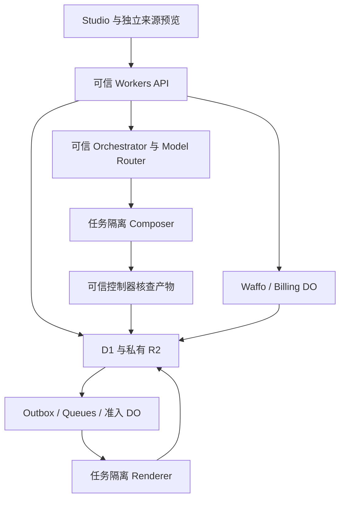

# 技术架构与数据契约

业务 API、鉴权、账务和模型凭据属于可信层；Composition 代码、评论、素材内容与沙箱输出都视为不可信数据。跨模块契约见 [14](14-production-contracts.md)，认证细则见 12，交易细则见 05。

## 1 技术与职责

| 层 | 技术与责任 |
| --- | --- |
| 网站/API | React、TypeScript、React Router/Vite、Cloudflare Workers/Static Assets；SSR、鉴权和协调 |
| UI | Tailwind、shadcn/ui Base UI、Lucide；杂志排版与专业工具配色，网站语言/主题见 10，交互与视觉见 02 |
| 状态/文件 | D1 业务记录；私有 R2 不可变素材、源码、音轨、帧、输出和必要证据 |
| 调度 | Queues、DO、outbox、租约与 generation、原子账务、全局算力准入 |
| AI | 一个可信 Orchestrator + 工具 + Model Router；Workers AI 可处理轻量任务，编码模型经真实基准配置 |
| 计算 | Composer/Renderer 独立沙箱，Node/Chromium/FFmpeg/ffprobe；都可能执行不可信代码 |
| 外部业务 | Google OIDC、Cloudflare Email Sending、Waffo；密钥留可信 Worker |
| 工具/观测 | mise、pnpm、精确锁文件，脱敏 Logs/Analytics，Access + 应用 admin |

不另引入数据库/部署厂商；Workers HTTP 只协调，不承担长时间 Chromium 或模型编排。返回持久 job ID，浏览器轮询不能成为交付依赖。

## 2 素材、源码和数据发送

准入来自 01 和 [输入配置](../../config/input-capabilities.json)。上传、解码、素材理解和方向生成前必须登录，且当前项目有已绑定试用或有效付费处理权益；无资助的新草稿不得先消耗这些云资源。检验魔数/解码而非扩展名，限制文件大小、像素、时长、线程和内存；图片方向/色彩规范化，音频规范化 48 kHz。录屏可以生成 H.264 预览代理，但必须先验证目标 Chromium 构建支持的解码器；不支持则用经过验证的预览抽帧，不能假设开源 Chromium 自带 H.264/AAC 解码。正式 Renderer 对实际使用的视频区间默认以 FFmpeg 按 PTS 确定性抽帧并复用受限缓存（含变帧率），不是无条件抽取所有上传帧；缺帧、PTS 不连续或资源越界明确失败。原始媒体与规范化 asset_version 都不可变。用户上传 HTML/SVG 与 Agent 在沙箱编写 HTML/SVG 严格区分。

上传 intent 收取用途、文件名、媒体类型、预先计算的 SHA-256、字节数及 `rightsDeclaration`。声明列明告知版本、owned/licensed 依据、处理/预览/商用范围、人物权利与限制；服务端记录声明人和时间，绑定 workspace/project、来源 hash/长度、临时 key 和截止。文件名仅作显示，不生成存储路径。声明是保存的依据，不自动证明真实授权；首次处理前执行 09/14 的用途准入，免费预览同样适用。

complete 只收 `requestId/uploadId`，服务端比对 intent 与实收字节、hash、魔数及解码边界；不匹配返回 422，不创建可用版本或启动后续模型处理。重试复用原结果，正式素材及规范化版本不可变。`purpose=evidence` 也走此流程、现行格式及相应大小/时长和总量限制；它只供事实/权利证据登记，不进入可绘资源清单，也不满足创作必需的视觉素材。账号、项目和素材归属取数据库，不信客户端自报。

只向已批准 provider 发送该用途所需的最小任务数据，如素材摘要、必要帧、转写所需音频或改稿涉及的源码片段，记录用途、provider 和数据范围；具体数据处理、日志与保留规则见本章第 6 节。

`project_revisions` 是唯一成片 revision 实体。CompositionManifest、ReleaseSnapshot、FactManifest、EditRequest/PatchResult、RenderProtocol 使用正式 Schema 和 14 的语义。源码可自由实现 DOM/SVG/Canvas/WebGL/3D/Shader，镜头及风格无固定枚举。绝对帧时钟、受控资源准备、冷/正/逆向 seek、精确消息身份与截图可信来源由 14 定义。

CompositionManifest 的 `layoutRulesHash` 固定响应式布局规则；各 variant 的 `targetOverrideHash` 固定该目标确有必要的独立覆盖，没有覆盖时显式为 null。二者进入 variant/content 身份计算，与源码、字体、音轨和运行环境一同冻结；不能只保存目标尺寸后在导出时重新决定构图。

购买并导出前准备全部合法目标来源；高清文件延后编码，补平台不再调用模型。先购买创作额度不要求素材或快照，也不触发任何导出。预览与导出读取相同 runtime、源包、字体、音轨和冻结规则，输出帧需在冷/顺/逆向路径上可复现；预览允许使用不同媒体代理，但不能隐藏与最终抽帧/解码的内容差异。网站主题、Cookie、浏览器语言不改变成片。

已暴露参数的本地编辑/回放不按点击收费；自动保存去抖，云预览、素材预处理、QA与平台准备仍通过操作准入、指纹缓存及独立费用预算。换素材不等于无模型操作；涉及新理解/转写时明确归类。只读取跨项目复制的合法不可变引用不会赠送处理/创作额度；新上传、新处理或AI任务按新项目权益检查。

## 3 队列、资源与隔离

业务更新与 outbox 在同一 D1 原子批次提交；dispatcher/Cron 扫描漏发，不依赖进程内 waitUntil。Queues 至少一次投递，重复消息复用同一 job，generation 作为 fencing token 阻止晚到结果覆盖。Billing DO 按项目协调 checkout、grant、快照预留、退款冻结和首次发布；网络等待后重新读取权威状态。

成功结果持久化后 ack；可恢复失败先原子写 attempt 和定时重试 outbox 再 ack；持久化失败不 ack。重试由一套应用调度控制，不同时叠加 Queue 重投与应用重试次数。渲染最多 3 次实际执行，退避 15/60 秒；模型内部修复最多 2 轮，累计预算共享。无效素材、未确认事实、确定性违规不盲重试。

[算力配置](../../config/agent-policy.json) 的全局 4 个物理容器覆盖素材、Composer、预览、音频、QA、Renderer 全部类别；工作区最多 2，创作/渲染各 1。子工具复用同容器令牌或另申请，不能持有全部令牌等子任务造成死锁。等待用户/预算暂停释放容器，已收款任务有预留容量和优先级。单次尝试、心跳与无心跳核查期限取配置；硬超时不是公开 SLA。

Composer/Renderer 都按 job/generation 隔离，结束销毁；不复用含客户源码、内存或文件的长期进程。实例是信任边界，不以不同 Linux 用户冒充隔离。默认禁公网，不携带支付、模型、D1/R2 管理或云平台凭据；资产代理只给当前任务的只读输入与有限输出。依赖离线镜像、锁定和许可审核，禁止未审查生命周期脚本。

不信源码自报 QA。预览使用独立 origin、无主站 Cookie、CSP/iframe 限权，bridge 校验 origin/source/nonce/session/schema；具体按 14。普通退出不取消已付款渲染，成员撤销/项目墓碑阻止未提交创作副作用。M0b 在真实 Cloudflare 验字体、视频 seek、WebGL 能力、编码、销毁重建和跨任务残留；本地 PoC 不替代。

## 4 实体与原子性

身份：users、auth_identities、auth_flows、auth_action_intents、email_challenges、sessions；工作区：workspaces、memberships、invites。证明、identity 唯一性、登录恢复按 12。D1 查询显式限定租户，不依赖自动 RLS。

试用：`trial_claims` 以内部 user_id 和 trial_project_id 分别唯一，保存 workspace_id、claimed_at 和政策版本。Owner 自领、项目创建、claim/grant 同事务；requestId 重试返回同项目，并发最多成功一次。`requestTrial` 默认 false；`trialStatus` 使用 not_requested/granted/unavailable，不可领取仍可建无权益草稿。身份或项目变化不重置 claim，最小去重关系按第 6 节保留；资格、次数和使用范围统一见 05/12。

内容：projects、product_facts、assets/asset_versions/asset_refs、upload_intents/rights_declarations、asset_transcripts、project_revisions、composition_sources/variants、creative_briefs/treatments、agent_runs/agent_run_steps、agent_candidates/agent_patches、fact_manifests/quality_reports、comments/edit_requests；独立展示授权为 showcase_consents。字段/关联/状态见 14 与本章 API；可无 scene/element 标记，不强制场景结构。

交易：orders、active_checkout_slots、entitlement_grants、credit_reservations/credit_ledger、payment_inbox、refund_requests、export_snapshots/export_releases/export_artifacts、jobs/job_attempts、outbox、renderer_versions。creative_reservations/creative_ledger 与成片账本分开。按 05 的购买资格、项目初始槽/升级槽、依赖退款与重新购买条件建唯一约束；条件写和 outbox 同事务，不无条件读后减余额。消费与费用不能因退款改写，旧付款去重关系不能被新订单复用；保存范围和期限见第 6 节。

货币使用整数最小单位，模型费用使用整数 USD micros；provider 单位由 adapter 明确转换。时间 UTC，UI 未知时区先标明 UTC，hydration 后可调整显示，但不改已确认的视频日期。素材、源码、事实、声音和 QA 构成引用图，清理必须先检查在途任务及有效购买。

### 成本计量与归因

M0a开始即建立cost_events及cost_reservations。一次模型请求或一个费用归集批次有稳定event_id/dedup_key；usage未知保留最坏预算，provider对账结果追加settlement/adjustment并关联原事件，不覆盖原始记录。记录实际支出，不因客户次数退还、候选拒绝、缓存复用或退款删除费用。

| 字段组 | 当前契约 |
| --- | --- |
| 归属 | environment、scope、actor_user_id、trial_owner_user_id、workspace_id、project_id、operation_id、attempt_id、target_id及可选order/release；从可信作业推导 |
| 用途 | acquisition_trial、paid_creation、target_preparation、preview、asset_processing、quality、export、shared；冷审、ASR、子帧、修复为可汇总子类 |
| 供应方 | provider/model、provider_request_id、price_version、method_package_version、renderer_image_digest；精确版本随操作冻结 |
| 用量 | 输入/缓存命中/输出tokens、CPU秒/内存GB秒/容器占用、R2读写次数与byte-hours等原始单位；未支持指标明确unknown |
| 金额 | 整数usd_micros、原币种/原金额及换算版本；estimated/actual/reconciled状态与实际计费周期 |
| 审计 | 发生/接收时间、预留/结算关系、去重键、原事件与调整原因；不保存prompt全文、token或客户源码 |

独立容器费用归实际持有任务；公共闲置、固定服务费与无法精确归属项记scope=shared，并按明确分摊规则汇总，不能伪造逐调用精度。R2按operation/attempt/类别批量计量，不为每次读写额外同步写一条D1；按供应商账单复核总量。多个逻辑target复用同一物理文件只记一次物理生产费用，分摊权重和为1；缓存命中也计实际读取费用。

费用准入与窗口算法统一见 14，数值来自 agent-policy；所有成功/失败费用及未知最坏预留都参与计算。客户次数退还、付款、退款、取消或重启不能清零实际费用。已收款交付的成本和容量事前预留，不以追加收费解除系统预算。金额上限和价格未标定时保持关闭；按 07 分别报告完整试用队列、首购、升级、追加和新项目复购，不将赠送、自测计为收入。

## 5 第一方 API

URI 和权限以 [路由配置](../../config/routes.json) 为唯一注册来源；关键请求/响应在 [API 契约](../../contracts/agent-api.json) 引用 [正式 Schema](../../contracts/production.schema.json)。已绑定对象使用封闭字段和明确分支；其余 API 在对应模块实施前补齐契约与负例，不能接受任意 object 代替。以下是可检查的实施清单，不是已部署服务。

普通业务 mutation 使用 requestId/Idempotency-Key，同时提供须一致；幂等范围包含 workspace/project/actor/route，请求摘要不一致返回 409。认证、外部回调的例外按 12/05，不把普通幂等缓存用于绕过 OTP 限次。Origin/CSRF、资源权限和生命周期在副作用前校验。无会话 401、已知角色不足 403、不可见资源 404、输入 422、限流 429；未知路径 404、方法 405+Allow。错误外壳为 code/messageKey/安全 params/message/fieldErrors/retryable/requestId。

| 方法与路径 | 最低权限 | 契约 |
| --- | --- | --- |
| `POST /api/auth/google/start` | public | 建立 Google 登录/关联/重新认证流程，state 与回跳约束按 12。 |
| `GET /api/auth/google/callback` | oauth_state | 验证 state、OIDC 证明与流程绑定；不以邮箱相同自动合并账号。 |
| `POST /api/auth/email/challenges` | public | 创建有预算限制的邮箱验证流程；返回值不泄露账号是否存在。 |
| `POST /api/auth/email/challenges/verify` | auth_flow | 验证当前流程 OTP 和尝试预算；身份确认与建会话按 12。 |
| `POST /api/auth/email/challenges/resend` | auth_flow | 同流程重发不刷新失败预算，旧码失效范围按 12。 |
| `GET /api/auth/session` | public | 返回最小会话与账号状态；无会话为匿名状态，不缓存。 |
| `POST /api/auth/logout` | public | 注销会话并清除认证状态；保留独立的网站主题偏好。 |
| `POST /api/auth/links/confirm` | auth_flow | 两种身份的有效证明及显式确认通过后原子关联。 |
| `POST /api/auth/registrations/confirm` | auth_flow | 验证注册意图与证明；未显式确认不创建关联账号。 |
| `DELETE /api/auth/flow` | auth_flow | 使当前认证流程及其证明失效，不注销其他会话。 |
| `POST /api/preferences` | public | 校验网站语言/主题白名单；Cookie 与账号偏好优先级按 10。 |
| `GET /api/workspaces` | session | 当前 session 的合法成员工作区，不接受任意 userId。 |
| `GET /api/workspaces/:workspaceId` | member | 当前成员的工作区、角色和品牌；不泄露其他租户。 |
| `PATCH /api/workspaces/:workspaceId` | owner | Owner 修改名称/品牌等允许字段并带版本 guard，不能伪造成员或额度。 |
| `DELETE /api/workspaces/:workspaceId` | owner | Owner、近期 reauth actionIntent、版本 guard 与明确确认；墓碑/取消/清理；财务保留和退款独立。 |
| `GET /api/workspaces/:workspaceId/members` | member | 成员身份与角色按必要范围返回。 |
| `DELETE /api/workspaces/:workspaceId/members/:userId` | owner | Owner、目标当前成员、版本 guard；不能移除最后 Owner；后续请求和在途副作用重查授权。 |
| `POST /api/workspaces/:workspaceId/invites` | owner | Owner，48 小时单次高熵邀请，返回复制链接；不自动发邮件。 |
| `DELETE /api/workspaces/:workspaceId/invites/:inviteId` | owner | Owner，邀请属于该工作区，撤销不删除已建立成员。 |
| `POST /api/invites/accept` | session | 显式接受并原子校验有效邀请、当前成员与 3 人上限；同用户成功重试幂等。 |
| `POST /api/workspaces/:workspaceId/owner-transfer` | owner | 当前 Owner、目标成员、版本 guard、对应 reauth actionIntent 与确认；原子消费证明并更换角色。 |
| `GET /api/projects` | member | 明确 workspaceId 与分页；只列授权工作区项目。 |
| `POST /api/projects` | member | createProjectRequest：workspaceId、audience=software/course、task、durationSeconds=15/30、合法targetIds、requestTrial；申请试用额外验Owner；返回项目及trialStatus，无必填视频语言。 |
| `GET /api/projects/:projectId` | member | 项目、草稿、权限、余额与期限，评论分页；匿名审阅不走本接口。 |
| `PATCH /api/projects/:projectId/draft` | member | baseRevision；changes 或 restoreFromRevisionId 二选一；创建新 revision 并 CAS，旧快照不变。 |
| `POST /api/projects/:projectId/copies` | member | 同工作区合法素材/源包引用；新projectId不带付费/试用权益，不重置claim。可只读/本地编辑；新上传、云预览、QA及创作前先购买project_pack的top_up_only权益；原项目的购买快照和QA授权不转移。 |
| `DELETE /api/projects/:projectId` | member | 删除确认、版本 guard、墓碑、取消、撤销授权、孤儿回收；退款独立处理。 |
| `POST /api/projects/:projectId/assets/intents` | member | `assetIntentRequest` → `assetIntentResult`，201；先验处理权益、预算和权利声明，返回绑定 hash/字节/用途的短期 PUT 授权。 |
| `POST /api/uploads/:uploadId/complete` | member | `uploadCompleteRequest` → `uploadCompleteResult`，202；实收字节匹配才接受处理，重复请求复用 processing/ready 结果。 |
| `GET /api/projects/:projectId/facts` | member | `no-body` → `factsResult`，200；读取当前事实、正文/记录版本、证据及确认状态。 |
| `PATCH /api/projects/:projectId/facts` | member | `factsUpdateRequest` → `factsResult`，200；逐项 CAS 创建、更新或移除，一批全部成功或 409。 |
| `POST /api/projects/:projectId/facts/confirm` | member | `factsConfirmRequest` → `factsResult`，200；确认精确正文 hash、正文版本及记录版本，确认人/时间由服务端写入。 |
| `GET /api/projects/:projectId/transcripts/:assetId` | member | `no-body` → `transcriptResult`，200；读取指定音频/录屏来源的已确认转写，无记录 404。 |
| `POST /api/projects/:projectId/transcripts/confirm` | member | `transcriptConfirmRequest` → `transcriptResult`，200；CAS 确认 assetId/sourceHash、时间段及关联事实，不代用户确认旁白。 |
| `POST /api/projects/:projectId/preflight` | member | 检查当前 revision；涉及云计算时先验项目权益与独立预算，不触发支付；`preflightRequest` → `qualitySummary`，200。 |
| `POST /api/projects/:projectId/export-snapshots` | member | 只冻结全部合法 target 已准备的内容；缺项 409；`snapshotRequest` → `releaseSnapshot`，200。 |
| `GET /api/projects/:projectId/export-snapshots/:snapshotId` | member | `no-body` → `releaseSnapshot`，200；只读指定持久快照，不准备目标或创建 checkout。 |
| `POST /api/billing/checkouts` | owner | `checkoutRequest` → `checkoutResult`，201；purchase_and_export 必须全目标快照，top_up_only 禁止 snapshotId；project_upgrade 必须有效初始 single_export 的 upgradeFromOrderId，其他 SKU 禁止该字段。资格/退款按 05，不收客户端金额、币种或权益。 |
| `POST /api/payments/waffo/webhook` | waffo_signature | 按 05 的订单、签名、权益和下载授权；沙箱不能直接调用。 |
| `GET /api/billing/orders` | owner | 按 05 的订单、签名、权益和下载授权；沙箱不能直接调用。 |
| `GET /api/billing/orders/:orderId` | owner | 按 05 的订单、签名、权益和下载授权；沙箱不能直接调用。 |
| `POST /api/projects/:projectId/exports` | member | 按 projectId + contentHash 复用或预留 release；`exportRequest` → `exportManifest`，202。 |
| `GET /api/exports/:releaseId` | member | `no-body` → `exportManifest`，200；刷新后恢复持久交付状态，独立于 job 和短期下载授权。 |
| `POST /api/exports/:releaseId/platforms` | member | 只执行已有冻结 target；不调用 Agent；`platformRequest` → `exportManifest`，202。 |
| `GET /api/jobs/:jobId` | member | 按实际 job 推导工作区；阶段、进度、安全错误码。 |
| `POST /api/exports/:releaseId/downloads` | member | 按 05 的订单、签名、权益和下载授权；沙箱不能直接调用。 |
| `POST /api/projects/:projectId/share-links` | member | 成员、不可变 revision 和期限；只读限定预览，不包含源码/账务/AI 权限。 |
| `DELETE /api/projects/:projectId/share-links/:shareLinkId` | member | 链接确属项目，撤销立即停止新授权；204。 |
| `POST /api/projects/:projectId/comments` | member | 纯文本成员评论，revision/target/帧可定位；普通评论不触发 AI 扣次。 |
| `POST /api/support/tickets` | session | `supportTicketRequest` → `supportTicketResult`，201；support 返回站内编号；refund 必须 orderId/reason，服务端核验该订单 Owner 后建立 refund_requests，非退款成功。 |
| `GET /api/projects/:projectId/showcase-consents/:releaseId` | owner | `no-body` → `showcaseConsentResult`，200；读取所选 release 的独立展示授权，未授予为 not_granted。 |
| `PUT /api/projects/:projectId/showcase-consents/:releaseId` | owner | `showcaseConsentRequest` → `showcaseConsentResult`，200；按 expectedVersion 授予或撤回指定渠道/用途，不影响生产权益。 |
| `POST /api/projects/:projectId/agent-runs` | member | 启动整片创作或显式准备平台源包；`agentRequest` → `runResult`，202。 |
| `GET /api/projects/:projectId/agent-runs/:runId` | member | 读取阶段、方向候选、预算与结果；`no-body` → `runResult`，200。 |
| `POST /api/projects/:projectId/agent-runs/:runId/resume` | member | 同 run 剩余预算内恢复；重新核对 base 和权限；`runAction` → `runResult`，202。 |
| `POST /api/projects/:projectId/agent-runs/:runId/cancel` | member | 取消并使该 run 的 generation 失效；baseRevision 匹配 run，不要求它仍是当前草稿；`runAction` → `runResult`，200。 |
| `GET /api/projects/:projectId/compositions/:revisionId` | member | 读取授权版本元数据；源码另走短期最小权限资产代理；`no-body` → `composition`，200。 |
| `POST /api/projects/:projectId/previews` | member | 精确帧或短片段预览，不开放免费高清交付；`previewRequest` → `previewResult`，202。 |
| `GET /api/projects/:projectId/previews/:previewId` | member | 读取该 revision/target 的预览状态；`no-body` → `previewResult`，200。 |
| `POST /api/projects/:projectId/edit-requests` | member | 一轮明确提交的comments数组，1..5条且合计≤4000 Unicode码点，每条有target/frame/可选point等；共同baseRevision/requestId，一轮只计一次成功修改；`editRequest` → `runResult`，202。 |
| `GET /api/projects/:projectId/patches/:patchId` | member | 显示影响范围和候选状态；`no-body` → `patchResult`，200。 |
| `POST /api/projects/:projectId/patches/:patchId/apply` | member | 接受：CAS 与权限、QA 同事务；`applyRequest` → `patchResult`，200。 |
| `POST /api/projects/:projectId/patches/:patchId/reject` | member | 拒绝该 base 的候选；不要求当前草稿仍等于该 base，不修改草稿；`applyRequest` → `patchResult`，200。 |
| `GET /api/projects/:projectId/quality-reports/:revisionId` | member | 读取与内容和资源匹配的逐目标报告；`no-body` → `qualitySummary`，200。 |

review token 只经专门 loader 读取限定版本的最小预览，不调用成员全量接口。comments 不隐式触发收费 AI，需要改稿时明确提交 edit-requests。金额、provider、回跳 origin、目标宽高、预算或权限不接受客户端任意覆盖。

### 关键接口语义

路径 ID 与 body ID 必须相等；所有引用重新查验当前租户、项目、成员和生命周期。读接口无业务副作用，均 `private, no-store`。Schema 只校验结构，不能替代以下服务端判断：

- **付款与上传授权。** `checkoutResult` 只返回本地 orderId、订单/会话状态和受控 URL/截止，不透传提供方对象。只有 ready 会话有 HTTPS checkoutUrl；pending/closed 均为 null，pending 不另开付款会话。服务端核对实际会话、允许的提供方主机和有效截止，禁止凭 HTTPS 字符串放行任意地址。上传 URL 同样只授权该 intent 的临时对象、PUT、长度/类型及期限；complete 再检查当前权限与实际字节，处理预算和费用不因重试重置。
- **事实编辑与确认。** `changes[].expectedVersion` 对应每项 `recordVersion`，0 仅创建从未使用的 factId；实际编辑或确认状态改变时递增记录版本。`version` 是正文版本，仅正文改变时递增，`textHash=digest(text)`；证据变化不得改变正文身份或计费 hash，但须清除该记录的旧确认和当前 QA。批内 factId 唯一，CAS 全部原子通过，移除不破坏已冻结 FactManifest。确认同时匹配 factId/version/textHash/expectedRecordVersion；确认人和 UTC 时间取有效会话及服务端时钟，Agent 不能代确认。
- **证据与转写。** 事实的 `evidence` 只提交 assetId/sourceHash；服务端核验该项目已完成的 evidence 上传，并生成绑定来源字节及当前文案 hash 的 evidenceRefs。14 的事实分类及来源要求仍适用，客户确认不自动证明真实性。转写绑定不可变 assetId/sourceHash，expectedVersion=0 为首次，其后匹配当前转写版本；各段按时间升序、不重叠、落在实测时长内，合计原文不超过 6000 Unicode 码点。商业声称关联当前已确认的 factId/version/textHash，并接受文本覆盖检查；空 facts 不能绕过声称检查。`transcriptHash=digest({assetId,sourceHash,segments})`，确认人/时间由服务端写入；来源或事实变化须重新确认受影响的转写。
- **展示与退款。** 展示 grant 必须当前 Owner、有权许可、已交付且确属该项目的 release、告知版本及明确所选渠道；scope 仅为该成片的 product_showcase，不延伸到原始素材或训练。revoke 使用当前版本，不要求仍有创作额度或媒体处于可编辑期，立即停止新增使用并安排撤下受控展示；旧 grant 的重放不能恢复已撤回授权。普通支持的可选 project/order 必须可见且关联一致；refund 分支额外核验订单 Owner，按 05 进入退款申请及依赖核查，不接受客户端金额/权益，不把 requested 当作退款到账。

持久 export/snapshot GET 只返回授权范围的清单元数据，不生成媒体授权、不延长期限，也不恢复已撤销的交付权益。短期文件授权仍由 downloads 接口按当前订单、release 和项目生命周期单独签发。

## 6 隐私、保存与删除

### 数据角色与处理范围

按实际活动判断责任：账号、安全、反滥用和经营分析由平台决定其处理目的；客户为制作任务提供的个人信息通常由客户决定用途、平台按约处理。Cloudflare、模型和其他分包方分别列入处理链；Waffo 的销售、支付及合规责任按实际合同判断，不能把所有第三方统一称为平台的处理者。上线前明确适用的数据处理协议、子处理者授权/变更告知及异议渠道、跨境传输安排和事件响应责任；法律依据见 [09](09-sources-and-decisions.md)。

默认不以客户素材、提示、源码、声音或成片训练模型，不跨工作区复用私有创作资料，不用于公开案例或营销。用户主动开启的工作区偏好只用于该工作区；分享审阅不构成公开展示同意。

案例展示单独征求默认未选、具体且可撤回的同意；当前仅可选择已交付 release 及 website_examples/social_media/advertising 渠道，不包含原始素材或训练。记录用途、告知版本、授权人及同意/撤回时间，核对其有权许可该范围。拒绝不影响制作、付款或下载。撤回后停止新增使用并从平台控制的展示页面/投放素材撤下；第三方已转发或下载副本的实际限制在同意时说明，不承诺删除整个互联网。撤回展示、删除项目和退款分别处理，保留必要的同意/撤回证明不等于继续公开作品。

API 不训练承诺与供应方日志保留是不同事项。选定模型/ASR 前核实实际账户设置、合同、用途、区域、保留期限和删除能力，再写入对外告知；不得仅凭某个产品入口的通用说明承诺零保留。云端自托管转写仍涉及云基础设施，转写文本交给模型时也计入数据处理范围。常规日志只记录必要的状态、用量和受控引用，不保存客户全文、原始媒体、私有源码、访问令牌或敏感 prompt。

### 隔离、缓存与公开标记

私有素材缓存键至少包含 workspace、输入字节 hash、处理器版本和参数；命中后仍核验当前项目的素材引用、用途和处理权益，不能用另一租户的 hash 命中绕过授权或透露其素材存在。客户私有缓存与经过许可的平台公共资源缓存分开管理。复制项目只继承获准引用，不复制授权范围或赠送新处理额度。

对外 AI 标记只包含履行披露所需的最小信息；客户身份、提示、私有素材 URL 和权利证明原文不随 C2PA/媒体元数据公开。受控权利记录、事实证据和最终文件标记的绑定按 14 校验。

### 生命周期与删除

项目正常保存期、续期和只读宽限统一按 05。主动删除立即设置墓碑，撤销分享和新下载授权，取消任务；24 小时内清理本服务在线业务存储中已无合法引用的媒体。迟到结果进入孤儿回收，不复活项目；暂存期和退款宽限不能延长用户主动删除时限。活动引用须属于仍有依据的任务/项目，不能用无期限“审计需要”保留全部素材。

备份、供应方日志和灾备副本按实际合同与恢复机制分别设定可核验的清除周期，上线前列入保留表和删除演练；不能将在线媒体的 24 小时目标表述为所有第三方副本的保证。恢复备份时重放删除墓碑，防止数据重新开放。

订单对账、付款去重、防重复试用、争议与许可证明仅保留所需最小字段、条款/同意版本、授权记录和必要输出 hash，分别注明目的、访问权限、期限或终止条件；可用最小证明完成目的时，不持续保存完整源码、录屏或成片。退款不改写消费和费用历史，但个人信息仍遵守对应保存/删除要求。

数据访问、更正、导出和删除请求通过已认证的设置或支持渠道处理，并核实主体与租户权限。云端文件删除、到期和停止下载，与已经合法取得的成片使用权分别按 05 处理。

## 7 发布隔离

生产和预发布 D1/R2/Queues/DO/支付配置/密钥独立。认证和个性化 HTML/API no-store，绕过共享缓存；仅公共静态内容可 CDN 缓存。renderer 注册表保存真实可执行应用/镜像/runtime/资源绑定，保留到有效引用结束；新部署不改变已购快照，安全修复使用审计更正版。发布/回滚不能删除订单或误报外部验证成功。
